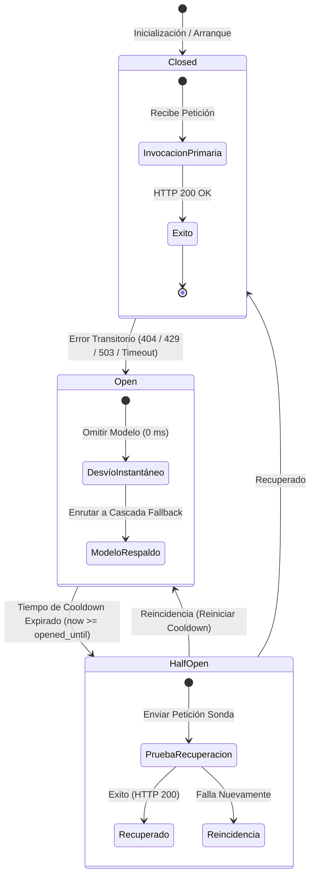

# Arquitectura de Resiliencia de IA y Centralización de Configuración — Ateneo+ v1.0.0

Este documento técnico formaliza el diseño, implementación y ciclo de vida del subsistema de inferencia resiliente (**ResilientLLMGateway**) y el esquema de configuración bajo el paradigma **12-Factor App (Single Source of Truth)** en la plataforma **Ateneo+ (v1.0.0)**.

---

## 1. Motivación y Causa Raíz

En sistemas de simulación clínica interactiva asistidos por modelos de lenguaje de gran escala (LLM), la disponibilidad y predictibilidad de la inferencia resultan indispensables:

1. **Obsolescencia Dinámica de Modelos en la Nube:** Proveedores externos como Google retiran o deprecian versiones previas de sus APIs (por ejemplo, el retorno de error HTTP `404 Not Found` en identificadores de modelo descontinuados como `gemini-2.5-flash` para nuevos proyectos).
2. **Límites de Tasa y Cuotas Transitorias (HTTP 429):** La concurrencia docente o las ráfagas evaluativas pueden agotar temporalmente las cuotas por minuto (RPM) o tokens por minuto (TPM).
3. **Penalización por Reintentos Ciegos (Latencia Fantasma):** Un ciclo lineal ingenuo de reintentos (`for model in models`) impone esperas secuenciales de 10 a 30 segundos a cada usuario concurrentemente si el modelo inicial no responde, degradando la experiencia en el aula clínica.
4. **Dispersión de Configuración:** La coexistencia de múltiples archivos `.env` en directorios raíz y subcarpetas introduce asincronía en despliegues con Docker.

---

## 2. Diagrama de Arquitectura y Máquina de Estados

El siguiente diagrama ilustra la arquitectura de enrutamiento tolerante a fallos y la máquina de estados del Circuit Breaker:



---

## 3. Especificación del ResilientLLMGateway (`backend/core/llm_gateway.py`)

### 3.1 Estados del Circuito (`CircuitStatus`)

| Estado | Descripción Técnica | Comportamiento ante Petición Entrante |
| :--- | :--- | :--- |
| `CLOSED` | El modelo opera con normalidad. | Se invoca directamente como primera opción. |
| `OPEN` | El modelo falló previamente con un error transitorio. Se encuentra en periodo de cuarentena. | Se omite de forma instantánea (**0 ms de latencia**) y se pasa al siguiente modelo de la cadena. |
| `HALF_OPEN` | El tiempo de enfriamiento (`GEMINI_CIRCUIT_COOLDOWN_SECONDS`) ha vencido. | Permite que una única petición evalúe si el servicio externo se ha restablecido. |

### 3.2 Clasificación Semántica de Excepciones

El Gateway discrimina estrictamente la causa raíz del error HTTP retornado por la API:

| Código / Cadena de Error | Clasificación | Acción del Gateway |
| :--- | :--- | :--- |
| `401 Unauthorized`, `403 Forbidden`, `API_KEY_INVALID`, `PermissionDenied` | **Error Fatal** | Lanza `FatalLLMException` de inmediato. No reintenta en otros modelos para evitar ciclos inútiles con credenciales corruptas. |
| `404 Not Found`, `no longer available` | **Modelo No Disponible** | Marca el modelo en `OPEN` por el tiempo de cooldown y conmuta al siguiente nodo de la jerarquía. |
| `429 Too Many Requests`, `ResourceExhausted` | **Cuota Agotada / Rate Limit** | Marca el modelo en `OPEN` por 300 segundos y delega la petición al modelo de respaldo. |
| `503 Service Unavailable`, `Timeout`, `Unavailable` | **Fallo Transitorio de Servidor/Red** | Abre el circuito temporalmente y conmuta en cascada. |

---

## 4. Cadena de Fallback Configurable

La jerarquía de conmutación se parametriza externamente sin requerir recompilación de código:

```dotenv
GEMINI_MODEL=gemini-3.8-flash
GEMINI_FALLBACK_MODELS=gemini-3.7-flash,gemini-3.5-flash,gemini-flash-latest,gemini-flash-lite-latest
GEMINI_CIRCUIT_COOLDOWN_SECONDS=300
```

### 4.1 Principio de Degradación Gradual Clínica (*Graceful Degradation*)

En sistemas de evaluación médica y simulación formativa, la jerarquía de conmutación prioriza la **profundidad de razonamiento diagnóstico y fidelidad a la GPC** antes de degradar hacia modelos económicos/ligeros:

| Nivel | Modelo | Latencia Mediana | Ventana Contexto | Rol en la Cascada Clínica |
| :---: | :--- | :---: | :---: | :--- |
| **1 (Primario)** | `gemini-3.8-flash` | 2,456 ms | 1,048,576 tokens | **Inferencia Principal:** Máxima agudeza médica, multimodalidad y JSON estricto. |
| **2 (Respaldo 1)** | `gemini-3.7-flash` | 2,664 ms | 1,048,576 tokens | **Potencia Completa:** Mantiene el 100% del rigor clínico si 3.8 está saturado. |
| **3 (Respaldo 2)** | `gemini-3.5-flash` | 1,744 ms | 1,048,576 tokens | **Flash Estándar:** Alta velocidad y comprensión probada de tablas GPC. |
| **4 (Respaldo 3)** | `gemini-flash-latest` | 2,865 ms | 1,048,576 tokens | **Alias Canónico:** Apunta a la versión general estable de Google. |
| **5 (Salvavidas)** | `gemini-flash-lite-latest` | **818 ms** | 1,048,576 tokens | **Alta Disponibilidad:** Red de seguridad final para evitar caídas ante cuota crítica. |

> [!NOTE]
> **Fundamentación:** Conmutar directamente a un modelo *Lite* ante el primer fallo degrada prematuramente la evaluación clínica de dosis y paraclínicos. Los modelos *Lite* se reservan como salvavidas de disponibilidad final.

---

## 5. Centralización de Entorno (12-Factor App)

Para garantizar la reproducibilidad y eliminar la deuda técnica por duplicidad:

* **Raíz Única:** Todo el stack (`docker-compose.yml`, FastAPI en host o contenedor, Vite Frontend) lee de un único archivo [.env](.env).
* **Validación Tipada con Pydantic:** [backend/core/config.py](backend/core/config.py) implementa `AppSettings`, validando tipos, rutas absolutas resueltas (`Path(__file__).resolve().parent`) y configuración de CORS antes de permitir peticiones HTTP.
* **Orquestación en Docker:** [docker-compose.yml](docker-compose.yml) inyecta las variables con `env_file: - .env` e implementa `start_period: 30s` en el healthcheck del backend para acomodar la carga del modelo transformer `BAAI/bge-m3` (2.2 GB) sin marcar estados insalubres falsos.

---

## 6. Soporte Agnóstico Universal y Evaluadores Locales On-Premise (OpenAI-Compatible)

Para garantizar la soberanía de datos hospitalarios (cumplimiento LOPDP) y permitir el uso de modelos médicos fine-tuneados propios sin dependencia de proveedores comerciales en la nube, el sistema implementa el **patrón Adapter** en `ResilientLLMGateway`:

### 6.1 Parámetros de Entorno

```dotenv
# Proveedor activo: 'gemini' (predeterminado) o 'openai_compatible'
LLM_PROVIDER=openai_compatible

# Endpoint del servidor local de inferencia
CUSTOM_LLM_BASE_URL=http://localhost:11434/v1

# Identificador del modelo levantado localmente
GEMINI_MODEL=llama3.1:8b

# Parámetros opcionales
CUSTOM_LLM_API_KEY=not-needed
CUSTOM_LLM_TIMEOUT_SECONDS=60
```

### 6.2 Opciones de Despliegue Local para Evaluadores Propios

1. **Ollama (Estaciones de Trabajo y Servidores Locales):**
   ```bash
   ollama pull llama3.1:8b
   # Ollama expone automáticamente el endpoint OpenAI-Compatible en http://localhost:11434/v1
   ```
2. **vLLM (Servidores Hospitalarios con GPU NVIDIA Dedicada):**
   ```bash
   python -m vllm.entrypoints.openai.api_server \
     --model ./mis_pesos_finetuneados_medicos \
     --port 8000 \
     --max-model-len 8192
   # Expone la API en http://localhost:8000/v1
   ```
3. **llama.cpp / Servidores GGUF (Inferencia Cuantizada en CPU):**
   ```bash
   ./llama-server -m ./mi_modelo_medico_q4_k_m.gguf -c 8192 --port 8080
   # Expone la API en http://localhost:8080/v1
   ```

### 6.3 Mecánica del Gateway y Contrato JSON
* **Modo JSON Estricto:** El adaptador inyecta automáticamente `"response_format": {"type": "json_object"}` para forzar la emisión estructurada de `score`, `aciertos`, `omisiones`, `competencias_deficientes` y `cita_normativa`.
* **Soporte Multimodal en Base64:** Si la simulación incluye radiografías o electrocardiogramas, las imágenes se transforman a Base64 estándar dentro del payload de mensajes de usuario.
* **Streaming en Tiempo Real:** Compatible con Server-Sent Events (SSE) leyendo bloques `data: {"choices": [{"delta": {"content": ...}}]}` para debriefing socrático sin latencia.
