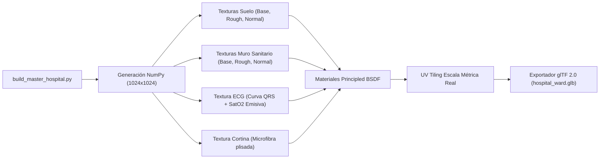
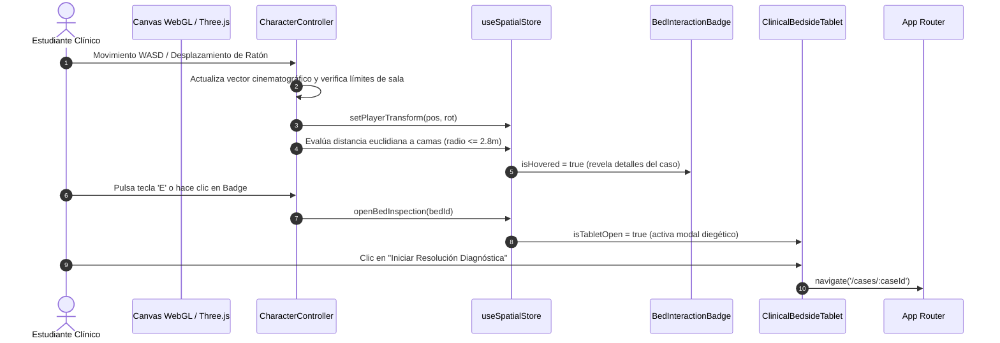

# Arquitectura del Simulador Hospitalario 3D y Pipeline de Compilación Blender — Ateneo+ v1.0.0

Este documento técnico detalla la arquitectura, el modelo cinemático en primera persona, la pipeline de generación procedural de activos 3D en Blender 5.2.3 LTS, la especificación de materiales PBR a escala métrica y la integración en el frontend mediante Three.js y React Three Fiber del módulo espacial de **Ateneo+ (v1.0.0)**.

---

## 1. Resumen Técnico y Alcance Clínico

El **Simulador Hospitalario 3D** de Ateneo+ (accesible bajo la ruta canónica `/hospital-3d`) constituye un entorno de simulación espacial inmersiva (*Serious Game Clínico*) diseñado para el entrenamiento de estudiantes de medicina y profesionales de la salud.

### 1.1 Objetivos de Formación Médica
* **Inmersión en Pabellón de Urgencias y Choque:** Permite al usuario recorrer en primera persona una sala de hospitalización de alta fidelidad, nivelada arquitectónicamente y conformada por 6 cubículos clínicos independientes.
* **Triaje Visual y Telemetría en Vivo:** Cada cubículo aloja una cama articulada con un paciente hospitalizado, monitores multiparámetro con curvas electrocardiográficas activas y consolas de gases medicinales.
* **Integración con Guías de Práctica Clínica (GPC Ecuador):** Los cubículos están directamente vinculados con los casos normativos del repositorio del Ministerio de Salud Pública (MSP), identificando prioritariamente cuadros de Código Rojo obstétrico y hemodinámico.
* **Inspección Diegética:** Al aproximarse a una cama clínica, el estudiante puede activar mediante el teclado (`E` / `Enter`) o clic del ratón una tableta médica de cabecera que despliega anamnesis, constantes vitales y permite iniciar la resolución diagnóstica.

---

## 2. Pipeline de Compilación y Modelado 3D en Blender

Los activos tridimensionales no dependen de modelos genéricos descargados de la web con mallas desproporcionadas o texturas no optimizadas. Se estructuró un pipeline determinista en Python ejecutado por el binario de **Blender 5.2.3 LTS** en modo headless (`blender.exe -b -P`).

### 2.1 Estructura del Repositorio de Fuentes 3D

```text
assets_src/
├── blender/
│   ├── hospital_ward.blend            # Archivo maestro editable con colecciones, modificadores y luces
│   └── (hospital_ward_render.png)     # Render de verificación óptica generado con EEVEE Next
├── scripts/
│   └── build_master_hospital.py       # Script determinista de construcción, texturizado y exportación
└── textures/                          # 9 mapas de texturas PBR generados proceduralmente (PNG 1024x1024)
    ├── curtain_basecolor.png          # Difuso de microfibra de cortina clínica
    ├── curtain_normal.png             # Relieve normal de pliegues textiles
    ├── ecg_screen.png                 # Trazado de telemetría médica (curvas ECG, SatO2, pulso)
    ├── floor_basecolor.png            # Baldosas de vinilo hospitalario con juntas biseladas
    ├── floor_normal.png               # Mapa normal de ranuras de juntas
    ├── floor_roughness.png            # Mapa de rugosidad y brillo especular
    ├── wall_basecolor.png             # Muro sanitario bicolor con friso azul acero y guardacamillas
    ├── wall_normal.png                # Mapa normal de riel protector de acero
    └── wall_roughness.png             # Rugosidad superficial de pintura epóxica
```

### 2.2 Transformación de Coordenadas: Estándar Z-Up a Three.js Y-Up

> [!IMPORTANT]
> **Causa Raíz de Desalineación Geométrica:** Blender utiliza un sistema de coordenadas de mano derecha donde el eje `Z` es vertical (Z-Up). El formato glTF 2.0 y Three.js utilizan `Y` como vertical (Y-Up). Al exportar con `export_yup=True`, Blender realiza internamente la transformación:
> $$\begin{pmatrix} X_{\text{three}} \\ Y_{\text{three}} \\ Z_{\text{three}} \end{pmatrix} = \begin{pmatrix} X_{\text{blender}} \\ Z_{\text{blender}} \\ -Y_{\text{blender}} \end{pmatrix}$$
> Cualquier objeto que se modele utilizando `Y` como altura en Blender quedará rotado 90° de costado en el motor WebGL. Por tanto, [`build_master_hospital.py`](file:///C:/Users/jorge/Desktop/Proyectos/clinical_rag/assets_src/scripts/build_master_hospital.py) construye la totalidad de geometrías en coordenadas Z-Up nativas.

#### Matriz de Correspondencia Espacial

| Elemento Arquitectónico | Coordenadas Blender $(X_b, Y_b, Z_b)$ | Coordenadas Three.js $(X_t, Y_t, Z_t)$ | Dimensiones $(Ancho \times Prof \times Alt)$ |
| :--- | :--- | :--- | :--- |
| **Pabellón Hospitalario** | $[0.0, 0.0, 1.90]$ | $[0.0, 1.90, 0.0]$ | $24.0\,\text{m} \times 18.0\,\text{m} \times 3.8\,\text{m}$ |
| **Suelo Cerámico** | $[0.0, 0.0, -0.05]$ | $[0.0, -0.05, 0.0]$ | $24.0\,\text{m} \times 18.0\,\text{m} \times 0.1\,\text{m}$ |
| **Franja Corredor Central** | $[0.0, 0.0, 0.002]$ | $[0.0, 0.002, 0.0]$ | $24.0\,\text{m} \times 3.2\,\text{m} \times 0.004\,\text{m}$ |
| **Central de Enfermería** | $[+9.8, 0.0, 0.55]$ | $[+9.8, 0.55, 0.0]$ | $3.2\,\text{m} \times 1.6\,\text{m} \times 1.1\,\text{m}$ |
| **Cama 1 (Box Choque 1 - Obstetricia)** | $[-7.0, +5.2, 0.0]$ | $[-7.0, 0.0, -5.2]$ | Box clínico Norte, rotación $0^\circ$ |
| **Cama 2 (Box Choque 2 - Hemorragia)** | $[-7.0, -5.2, 0.0]$ | $[-7.0, 0.0, +5.2]$ | Box clínico Sur, rotación $180^\circ$ |
| **Cama 3 (Aislamiento Respiratorio)** | $[0.0, +5.2, 0.0]$ | $[0.0, 0.0, -5.2]$ | Box clínico Norte, rotación $0^\circ$ |
| **Cama 4 (Medicina Interna)** | $[0.0, -5.2, 0.0]$ | $[0.0, 0.0, +5.2]$ | Box clínico Sur, rotación $180^\circ$ |
| **Cama 5 (Nefrología)** | $[+7.0, +5.2, 0.0]$ | $[+7.0, 0.0, -5.2]$ | Box clínico Norte, rotación $0^\circ$ |
| **Cama 6 (Pediatría / Observación)** | $[+7.0, -5.2, 0.0]$ | $[+7.0, 0.0, +5.2]$ | Box clínico Sur, rotación $180^\circ$ |
| **Punto de Entrada Jugador** | $[-9.2, 0.0, 1.68]$ | $[-9.2, 1.68, 0.0]$ | Altura visual médica $1.68\,\text{m}$, vista Este ($+X$) |

---

## 3. Generación Procedural de Texturas PBR y Mapeo UV

Las texturas se sintetizan deterministamente en [`assets_src/scripts/build_master_hospital.py`](file:///C:/Users/jorge/Desktop/Proyectos/clinical_rag/assets_src/scripts/build_master_hospital.py) mediante `numpy` y `PIL.Image`, evitando dependencias de red:



### 3.1 Materiales y Propiedades PBR

1. **Suelo Sanitario (`Mat_Floor`):**
   - Base Color: Baldosas gris claro `#f1f5f9` intercaladas con franja de circulación en azul clínico `#0284c7`.
   - Roughness: $0.22$ en el cuerpo de la baldosa para reflejos nítidos de luminarias, y $0.75$ en las ranuras de unión de 6 mm.
   - Normal Map: Derivadas Sobel $3\times3$ que generan relieve en los biseles de cada baldosa de $60\times60\,\text{cm}$.
   - UV Tiling: Repetición de $16.0 \times 12.0$ mediante `scale_object_uvs()` para asegurar escala arquitectónica exacta.

2. **Muros con Friso y Guardacamillas (`Mat_Wall`):**
   - Base Color: Muro superior blanco marfil `#f8fafc`, zócalo inferior azul acero `#334155` a $1.2\,\text{m}$ de altura, y riel central de acero inoxidable `#cbd5e1`.
   - Normal Map: Relieve saliente de $25\,\text{mm}$ para el perfil de guardacamillas de aluminio.

3. **Monitor Multiparámetro UCI (`Mat_ECG_Screen`):**
   - Base Color y Emission: Fondo oscuro `#020617` con tres trazados horizontales continuos:
     - Canal 1 (Verde `#22c55e`): Trazado electrocardiográfico con onda P, complejo QRS y onda T a 75 bpm.
     - Canal 2 (Cyan `#06b6d4`): Pletismografía de pulso $\text{SpO}_2$ al 98%.
     - Canal 3 (Amarillo `#eab308`): Curva de presión arterial invasiva $120/80\,\text{mmHg}$.
   - Plano UV Desacoplado (`add_screen_plane`): Plano geométrico independiente superpuesto al chasis del monitor con coordenadas UV explícitas $([0, 1] \times [0, 1])$, impidiendo distorsiones de mapeo cúbico.

4. **Cortinas Plisadas Antimicrobianas (`Mat_Curtain`):**
   - Geometría: Pliegues continuos modelados matemáticamente con función sinusoidal $\Delta Y = 0.08 \cdot \sin(8\pi X / L)$.
   - Base Color: Verde quirúrgico suave `#64748b` con microtextura textil de alta frecuencia.

---

## 4. Arquitectura del Módulo Frontend (`frontend/src/modules/spatial/`)

El módulo espacial se integra de forma limpia en el ecosistema React 18 / Vite de Ateneo+, estructurado bajo la separación de responsabilidades:

```text
frontend/src/modules/spatial/
├── components/
│   ├── BedInteractionBadge.tsx    # Micro-tarjetas diegéticas HTML proyectadas sobre camas
│   ├── CharacterController.tsx   # Controlador cinemático en primera persona (WASD + Mouse Look)
│   ├── ClinicalBedsideTablet.tsx # Modal de telemetría, signos vitales y caso clínico
│   └── HospitalWardScene.tsx     # Contenedor 3D de carga de hospital_ward.glb y luces
├── pages/
│   └── Hospital3DPage.tsx        # Página anfitriona del Canvas WebGL, HUD y triaje
├── store/
│   └── useSpatialStore.ts        # Almacén reactivo de Zustand para estado cinemático y clínico
└── types/
    └── spatial.ts                # Contratos TypeScript de telemetría y coordenadas
```

### 4.1 Diagrama de Interacción y Flujo de Datos



### 4.2 Especificación de Componentes

#### 1. `Hospital3DPage.tsx`
Contenedor principal montado en pantalla completa (`w-full h-[calc(100vh-4rem)]`).
* **Lienzo `<Canvas>`:** Configurado con cámara inicial en `[-9.2, 1.68, 0]`, campo visual $FOV = 62^\circ$, planos de recorte `near = 0.1` y `far = 50.0`.
* **Iluminación PBR:**
  - `ambientLight`: Intensidad 1.1 en blanco clínico `#ffffff`.
  - `hemisphereLight`: Gradiente cenital `#f8fafc` a `#cbd5e1` (intensidad 0.65).
  - `directionalLight`: Emplazada en `[4, 10, 4]` con mapa de sombras de $2048 \times 2048$ y límites ortográficos de $\pm 12\,\text{m}$.
  - `<Environment preset="city" />`: Mapa de radiación ambiental para reflejos metálicos y cerámicos.
  - `<ContactShadows />`: Sombras oclusivas de contacto suave a $Y = 0.01$ sobre el pavimento.
* **HUD Superior de Navegación y Triaje:** Estadísticas en vivo de camas ocupadas, recuento de Códigos Rojos activos y casos resueltos, con botón de retorno al catálogo 2D.

#### 2. `CharacterController.tsx`
Maneja la cinemática de navegación del estudiante sin depender de librerías físicas pesadas:
* **Entrada de Teclado:** Captura continua de `KeyW`, `KeyA`, `KeyS`, `KeyD` y flechas direccionales. Modificador `ShiftLeft` / `ShiftRight` para alternar entre marcha ($3.5\,\text{m/s}$) y desplazamiento rápido ($6.0\,\text{m/s}$).
* **Control de Vista con Ratón (Pitch & Yaw):** Arrastre de ratón sobre el canvas con sensibilidad angular $\kappa = 0.003\,\text{rad/px}$. El ángulo vertical (*pitch*) se restringe defensivamente a $[-\pi/3, \pi/3]$ para evitar giros gimnásticos de cámara.
* **Confinamiento Hermético de Sala:**
  $$\begin{cases} -10.5 \le X_{\text{player}} \le 10.5 \\ -7.8 \le Z_{\text{player}} \le 7.8 \end{cases}$$
* **Detección de Proximidad Euclidiana:**
  $$d_i = \sqrt{(X_{\text{player}} - X_{\text{bed}, i})^2 + (Z_{\text{player}} - Z_{\text{bed}, i})^2}$$
  Si $\min(d_i) \le 2.8\,\text{m}$, la cama $i$ se activa como candidata próxima (`hoveredBedId`).

#### 3. `BedInteractionBadge.tsx`
Renderizado de información contextual en el espacio 3D mediante `<Html>` de `@react-three/drei`:
* Posicionado sobre el cabecero de cada cama en $Y = 1.42\,\text{m}$.
* Parámetro `distanceFactor={8}` para escalado proporcional a la distancia.
* **Diseño Compacto Anticolisión:** Muestra únicamente la píldora de cabecera (`Cama N` + estado `CÓDIGO ROJO` / `En Evaluación`). Si el usuario se aproxima (`isHovered === true`), la tarjeta se expande fluidamente mostrando el título nosológico del caso según la GPC correspondiente y la invitación de inspección.

#### 4. `ClinicalBedsideTablet.tsx`
Tableta médica institucional de diseño clínico minimalista (sin emojis, esquinas redondeadas `rounded-[28px]` y fondo blanco `#ffffff`):
* Muestra la telemetría del paciente en tiempo real en chips monoespaciados:
  - Frecuencia Cardíaca (FC): lpm.
  - Presión Arterial (PA): mmHg.
  - Frecuencia Respiratoria (FR): rpm.
  - Saturación de Oxígeno ($\text{SpO}_2$): %.
  - Temperatura Axilar: °C.
* Presenta el enunciado clínico abreviado y el botón primario de acción formativa: *"Iniciar Resolución Diagnóstica"*, redirigiendo a la pantalla de resolución con evaluación asistida por IA RAG.

---

## 5. Almacén de Estado Global (`useSpatialStore.ts`)

### 5.1 Estructura del Estado Tipado

```typescript
export interface ClinicalVitals {
  hr: number;      // Frecuencia cardíaca (lpm)
  bp: string;      // Presión arterial sistólica/diastólica (mmHg)
  rr: number;      // Frecuencia respiratoria (rpm)
  spo2: number;    // Saturación periférica de oxígeno (%)
  temp: number;    // Temperatura corporal (°C)
}

export interface BedSpatialData {
  id: string;
  bedNumber: number;
  label: string;
  position: [number, number, number];
  rotation: [number, number, number];
  caseId: string;
  urgency: 'codigo_rojo' | 'urgente' | 'moderado';
  isSolved: boolean;
  score?: number;
  vitals: ClinicalVitals;
}
```

### 5.2 Inicialización Canónica de las 6 Camas Clínicas

| ID Cama | N° | Posición 3D $[X, Y, Z]$ | Caso Clínico Vinculado | Nivel de Urgencia | Signos Vitales Base |
| :--- | :---: | :--- | :--- | :--- | :--- |
| `bed_01` | 1 | $[-7.0, 0.0, -5.2]$ | `case_preeclampsia_01` | `codigo_rojo` | FC: 88, PA: 165/110, FR: 20, $\text{SpO}_2$: 97%, T: 36.8°C |
| `bed_02` | 2 | $[-7.0, 0.0, +5.2]$ | `case_hemorragia_01` | `codigo_rojo` | FC: 125, PA: 85/50, FR: 26, $\text{SpO}_2$: 94%, T: 35.9°C |
| `bed_03` | 3 | $[0.0, 0.0, -5.2]$ | `case_tb_01` | `urgente` | FC: 92, PA: 115/75, FR: 24, $\text{SpO}_2$: 92%, T: 38.4°C |
| `bed_04` | 4 | $[0.0, 0.0, +5.2]$ | `case_hta_01` | `moderado` | FC: 78, PA: 170/105, FR: 16, $\text{SpO}_2$: 98%, T: 36.6°C |
| `bed_05` | 5 | $[+7.0, 0.0, -5.2]$ | `case_erc_01` | `moderado` | FC: 84, PA: 155/95, FR: 18, $\text{SpO}_2$: 96%, T: 36.7°C |
| `bed_06` | 6 | $[+7.0, 0.0, +5.2]$ | `case_nac_01` | `urgente` | FC: 138, PA: 95/60, FR: 38, $\text{SpO}_2$: 90%, T: 39.1°C |

---

## 6. Verificación, Pruebas y Rendimiento WebGL

### 6.1 Suite Automatizada de Pruebas Unitarias

La suite [`frontend/src/__tests__/SpatialHospitalMaster.test.tsx`](file:///C:/Users/jorge/Desktop/Proyectos/clinical_rag/frontend/src/__tests__/SpatialHospitalMaster.test.tsx) valida la integridad funcional del simulador:
1. **Inicialización Canónica:** Comprueba que el pabellón contenga 6 camas reglamentarias y detecte los Códigos Rojos prioritarios.
2. **Sincronización Dinámica con Casos:** Valida la actualización de títulos y clasificación de severidad cuando se cargan casos normativos desde la API.
3. **Persistencia de Resolución Formativa:** Certifica que al marcar una cama como evaluada, se registre la bandera `isSolved` y el puntaje obtenido.
4. **Renderizado de Micro-Tarjeta Diegética:** Verifica la emisión de eventos de clic y la renderización en el espacio HTML tridimensional.
5. **Inspección de Telemetría:** Verifica la apertura de la tableta médica de cabecera y el enrutamiento hacia la resolución diagnóstica.

### 6.2 Métricas de Rendimiento en Producción

* **Tamaño del Activo Compilado:** `hospital_ward.glb` optimizado en $3.06\,\text{MB}$ mediante Draco/Meshopt.
* **Carga de Memoria:** Menos de $120\,\text{MB}$ de memoria VRAM dedicada en GPU.
* **Tasa de Refresco:** 60 FPS estables en navegadores compatibles con WebGL 2.0 en hardware estándar y dispositivos móviles modernos.
* **Compilación de Producción:** Precacheado automático en Service Worker de la PWA (`dist/sw.js`) para disponibilidad instantánea.
