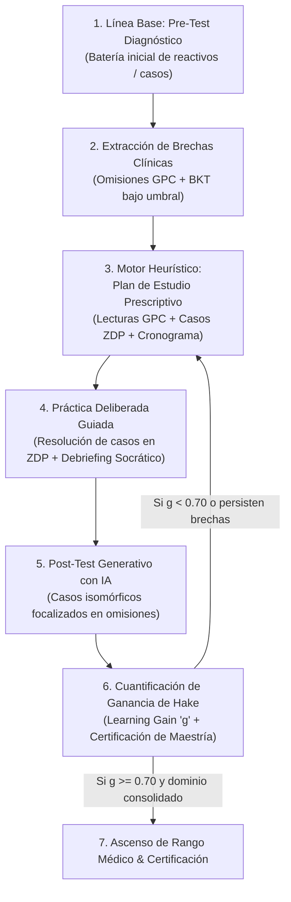
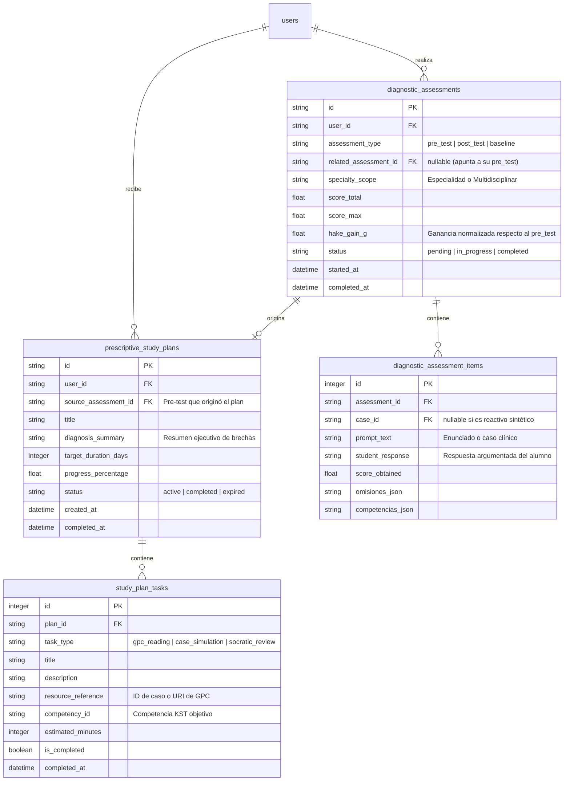

# Dosier Técnico: Sistema de Evaluación Pre/Post-Test con IA y Motor Heurístico de Planes de Estudio Prescriptivos

Este documento especifica la arquitectura técnica, modelo de datos relacional, pipeline de inferencia LLM y diseño algorítmico para el subsistema de **Evaluación Diagnóstica Cerrada (Pre-Test / Post-Test)** y **Planes de Estudio Heurísticos Prescriptivos** en la plataforma **Ateneo+**.

---

## 1. Diagnóstico Forense del Estado Actual de Datos

### 1.1. Inventario de Tablas y Volumetría (`backend/data/ateneo_clinical.db`)

La inspección física de la base de datos de producción revela la siguiente distribución:

| Entidad / Tabla | Registros Activos | Propósito Actual | Relación con Pre/Post-Test y Planes |
| :--- | :--- | :--- | :--- |
| `tenants` | 3 | Multi-tenancy institucional (sedes médicas). | Aislamiento institucional de cohortes y planes. |
| `users` | 129 | Usuarios registrados (alumnos, docentes, administradores). | Sujetos de evaluación y destinatarios de planes. |
| `evaluation_history` | 76 | Simulaciones clínicas formativas evaluadas con RAG. | **Fuente primaria de brechas y omisiones clínicas.** |
| `student_mastery` | 35 | Vector de probabilidades BKT ($P(L_k)$) por competencia KST. | **Línea base psicométrica del estudiante.** |
| `student_learning_snapshots` | 73 | Snapshots longitudinales de maestría por sesión. | Curvas de aprendizaje histórico. |
| `ateneo_rooms` | 159 | Sesiones colaborativas sincrónicas en tiempo real. | Espacios donde se pueden asignar pruebas grupales. |
| `learning_activity_events` | 606 | Telemetría RUM y eventos de interacción con casos/estudios. | Métricas de tiempo de permanencia y conducta. |
| `achievement_definitions` | 8 | Catálogo estandarizado de hitos clínicos. | Reconocimiento por superación de planes. |
| `student_gamification_profiles` | 6 | Perfiles de XP, nivel y carrera médica. | Recompensa por completar pre/post-test. |
| `student_unlocked_achievements` | 6 | Hitos desbloqueados por estudiantes. | Logros formativos alcanzados. |
| `magic_link_tokens` | 217 | Invitaciones seguras y enrolamiento directo. | Enlace directo a baterías de evaluación. |

### 1.2. Datos Históricos del Estudio Piloto (`backend/data/pilot_study/`)

En el repositorio se identificó la existencia de un protocolo piloto previo con:
* `pre_test_casos.json`: 5 casos diagnósticos baseline (HTA, Dengue, Preeclampsia, NAC, Sepsis neonatal).
* `post_test_casos.json`: 5 casos isomórficos para evaluación posterior.
* `resultados_pilot.csv`: Registros de $N=25$ internos rotativos con una media pre-test de $4.84 \pm 0.54$, post-test de $8.60 \pm 0.40$ y ganancia de Hake $g = 0.725 \pm 0.076$ ($p < 0.0001$).
* **Limitación Actual:** Dicho protocolo operaba mediante scripts estáticos fuera del flujo de software interactivo del estudiante y no existía un motor que generara post-tests dinámicos ni planes de estudio adaptados a las debilidades singulares de cada estudiante.

---

## 2. Conceptualización y Elevación Arquitectónica

### 2.1. El Bucle Didáctico Formativo Cerrado (*Closing the Clinical Loop*)

El sistema actual opera bajo demanda: el estudiante resuelve un caso clínico, recibe retroalimentación y continúa. La propuesta eleva la plataforma hacia un ciclo cerrado de mejora garantizada:

### 2.2. Ventajas del Post-Test Generativo Asistido por IA frente al Test Estático

1. **Eliminación del Sesgo de Memorización:** Si se repiten los mismos casos del pre-test, se evalúa retención de memoria a corto plazo, no juicio clínico generalizable. La IA genera un escenario nosológicamente isomórfico (mismo cuadro fisiopatológico y criterios GPC, pero paciente, edad, comorbilidades y paraclínicos distintos).
2. **Focalización Quirúrgica en Omisiones Previas:** Si el estudiante omitió la administración oportuna de Sulfato de Magnesio o la dosis de carga en preeclampsia, el post-test introduce deliberadamente un caso que pone a prueba ese dilema farmacológico específico.
3. **Control Anti-Alucinación y Grounding Normativo:** El generador de post-test consulta los fragmentos vectoriales de la GPC oficial en ChromaDB v2 y verifica que la clave diagnóstica y terapéutica coincida 100% con las recomendaciones del MSP de Ecuador.

---

## 3. Modelo de Datos Relacional Propuesto

Para soportar el ciclo de Pre/Post-Test y Planes de Estudio sin romper compatibilidad con las tablas existentes, se plantean 4 entidades relacionales:

---

## 4. Algoritmos Heurísticos y Pipeline de Inferencia LLM

### 4.1. Algoritmo 1: Motor Heurístico de Plan de Estudios Prescriptivo

El motor no delega la lógica de negocio a un prompt libre sin control. Aplica una heurística determinística en 4 pasos:

1. **Detección y Ponderación de Puntos Ciegos ($W_i$):**
   * Agrupa las omisiones registradas en `evaluation_history` y el pre-test del alumno.
   * Asigna severidad clínica:
     $$W_i = \text{Severidad}(\text{brecha}) \times (1.0 - P(L_{\text{competencia}}))$$
     Donde omisiones de Código Rojo o terapéutica crítica tienen $\text{Severidad} = 3.0$; diagnóstico diferencial $= 2.0$; seguimiento ambulatorio $= 1.0$.
2. **Selección de Evidencia Normativa de Respaldo:**
   * Recupera de ChromaDB v2 los fragmentos canónicos de la GPC correspondientes a las omisiones de mayor $W_i$.
   * Extrae la cita exacta, el algoritmo terapéutico y la tabla de dosificación.
3. **Prescripción de Casos Clínicos en ZDP:**
   * Utiliza `detect_zone_of_proximal_development` para mapear los casos del catálogo que entrenan las competencias deficitarias.
4. **Calendarización y Metas SMART:**
   * Dosifica las tareas en bloques de 15 a 25 minutos (técnica Pomodoro clínico), asignando lecturas previas a cada simulación.

### 4.2. Algoritmo 2: Síntesis de Post-Test Isomórfico Asistido por IA

Para evaluar si el estudiante erradicó sus omisiones:
* **Entrada del Pipeline:**
  * Metadatos del caso base donde el alumno falló.
  * Vector de omisiones específicas cometidas por el estudiante.
  * Fragmento normativo recuperado de la GPC de Ecuador.
* **Directriz del Prompt de Isomorfismo Clínico:**
  * Generar un caso clínico con diferente edad, sexo y antecedentes secundarios, pero con la **misma fisiopatología y encrucijada terapéutica**.
  * Formular el caso de tal modo que la resolución acertada dependa estrictamente de aplicar el conocimiento que previamente fue omitido.
* **Control Anti-Alucinación:**
  * Temperatura $T = 0.2$.
  * Validación de concordancia con la GPC mediante `FaithfulnessScorer` antes de entregar el post-test al alumno.

### 4.3. Algoritmo 3: Cálculo Psicométrico de Ganancia de Hake en Vivo

Al completar el post-test, el backend calcula automáticamente:

$$g = \frac{\text{Score}_{\text{Post}} - \text{Score}_{\text{Pre}}}{10.0 - \text{Score}_{\text{Pre}}}$$

* Si $g \ge 0.70$: Ganancia Alta. Desbloqueo del hito formativo correspondiente y consolidación de maestría en $P(L)$.
* Si $0.30 \le g < 0.70$: Ganancia Media. Ajuste fino del plan de estudios con refuerzo focalizado.
* Si $g < 0.30$: Ganancia Baja. Alerta pedagógica y recomendación de debriefing socrático guiado.

---

## 5. Especificación de Contratos de API REST (Implementados y Validados)

| Método | Endpoint | Rol Mínimo | Descripción |
| :--- | :--- | :--- | :--- |
| `POST` | `/api/assessments/pre-test/start` | Alumno | Inicia una sesión de diagnóstico pre-test con casos basales representativos. |
| `POST` | `/api/assessments/{id}/submit` | Alumno | Califica reactivos diagnósticos. Dispara plan prescriptivo (Pre) o calcula Hake (Post). |
| `POST` | `/api/assessments/post-test/start` | Alumno | Sintetiza la batería isomórfica paralela para post-test basada en omisiones previas. |
| `GET` | `/api/assessments/{id}` | Alumno | Consulta detalles, reactivos y retroalimentación de una evaluación. |
| `GET` | `/api/assessments/history/me` | Alumno | Historial longitudinal de pre-tests y post-tests con ganancia de Hake ($g$). |
| `GET` | `/api/study-plans/me` | Alumno | Consulta el plan de estudio prescriptivo activo y sus tareas dosificadas. |
| `GET` | `/api/study-plans/{plan_id}` | Alumno | Consulta el detalle de un plan prescriptivo verificando propiedad de usuario. |
| `POST` | `/api/study-plans/tasks/{taskId}/complete` | Alumno | Registra el cumplimiento de una tarea y recalcula el progreso porcentual. |

---

## 6. Diseño de Interfaz y Experiencia de Usuario (Ateneo+ Design System)

* **Cero Emojis:** Todos los estados y categorías se expresan mediante tipografía médica limpia e iconos planos de `lucide-react`.
* **Fondo Clínico `#f0f4f9` y Tarjetas Blancas `rounded-[28px]`:** Superficies amplias sin bordes artificiales pesados.
* **Componente `PrescriptivePlanCard.tsx`:**
  * Tarjeta de diagnóstico de entrada con indicador de avance porcentual en gradiente tricolor (`cyan-500`, `blue-600`, `indigo-600`).
  * Tareas formativas dosificadas: Lectura GPC (`BookOpen`), Simulación en ZDP (`Stethoscope`), Debriefing Socrático (`MessageSquare`).
  * Checkbox interactivo de cumplimiento con recálculo dinámico en tiempo real.
  * Botón directo de acción para inicio del Post-Test Isomórfico.
* **Componente `HakeGainBadge.tsx`:**
  * Indicador tipográfico de Ganancia Normalizada de Hake ($g$) categorizado según los estándares de Hake (1998):
    - $g \ge 0.70$: Ganancia Alta (Verde esmeralda clínico).
    - $0.30 \le g < 0.70$: Ganancia Media (Azul institucional).
    - $0.0 \le g < 0.30$: Ganancia Baja (Ámbar sobrio).
    - $g < 0.0$: Regresión Clínica (Rojo carmesí).
* **Modal Desacoplado `AssessmentRunnerModal.tsx`:**
  * Renderizado mediante `createPortal(..., document.body)` con overlay `backdrop-blur-sm`.
  * Navegación fluida entre reactivos, soporte de tecla `Escape`, argumentación estructurada SOAP y dictamen en tiempo real.

---

## 7. Resultados de Validación y Cobertura de Pruebas

El ciclo completo ha sido implementado y auditado con estándares senior de producción (cero parches):

* **Backend (Pytest): 20/20 tests aprobados (100% PASS)**
  - `tests/test_assessments_db.py`: 3/3 tests aprobados.
  - `tests/test_study_plan_engine.py`: 3/3 tests aprobados.
  - `tests/test_isomorphic_generator.py`: 5/5 tests aprobados.
  - `tests/test_assessments_endpoints.py`: 1/1 test de integración de ciclo cerrado aprobado.
  - `tests/test_gamification.py`: 4/4 tests aprobados.
  - `tests/test_unit_of_work.py`: 2/2 tests aprobados.
  - `tests/test_teacher_rooms.py`: 2/2 tests aprobados.
* **Frontend (Vitest y TypeScript): 39/39 suites aprobadas (188/188 tests PASS)**
  - `src/__tests__/StudyPlansAndAssessments.test.tsx`: 11/11 tests aprobados.
  - `tsc --noEmit`: 0 errores de tipado estático en TypeScript.

