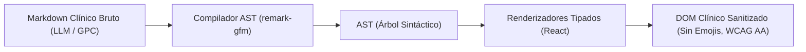
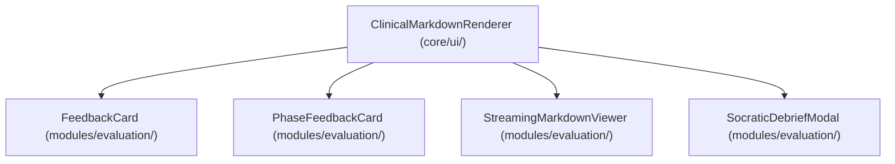
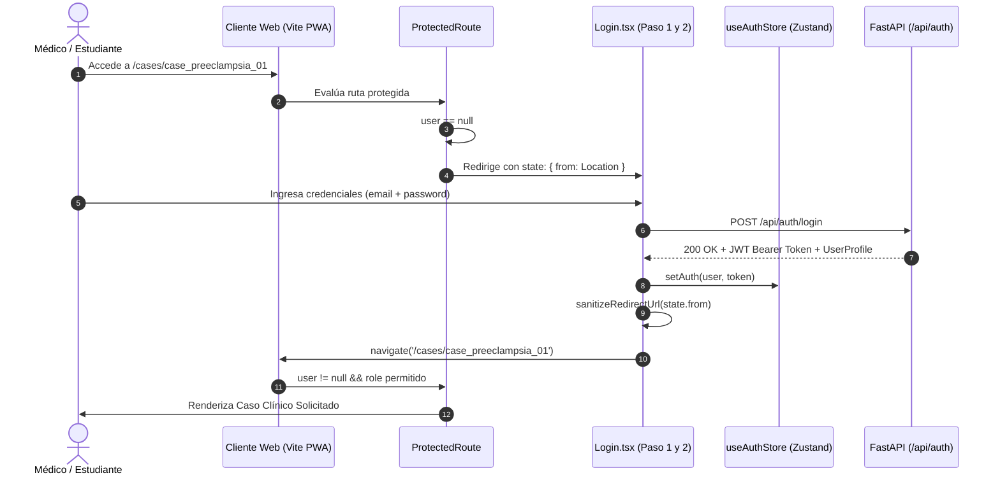

# Dosier Técnico: Motor de Renderizado Clínico AST y Arquitectura de Deep-Linking Seguro

Este documento técnico formaliza la especificación arquitectónica, decisiones de diseño, contratos de interfaz y protocolos de seguridad implementados en el cliente web y backend de **Ateneo+** para el procesamiento tipado de Markdown clínico formativo y la gestión segura de autenticación JWT y enrutamiento con preservación de contexto (*Deep-Linking*).

---

## 1. Justificación y Análisis de Causa Raíz

### 1.1 Fragilidad en el Renderizado de Dictámenes Clínicos
Con anterioridad a esta implementación, la visualización de la retroalimentación diagnóstica generada por el motor RAG/LLM dependía de transformaciones basadas en expresiones regulares (`replace(/\*\*(.*?)\*\*/g)`) o inserciones directas con `dangerouslySetInnerHTML`. Este enfoque introducía tres fallas estructurales:
1. **Ruptura de Tablas y Listas GPC:** Las tablas normativas de dosificación farmacológica y esquemas de tratamiento (ej. Sulfato de Magnesio en Preeclampsia) quedaban desestructuradas o renderizadas como texto plano sin bordes ni alineación.
2. **Vulnerabilidad a Inyección XSS:** El uso de inserciones HTML sin validación previa exponía al cliente a vectores de inyección en caso de respuestas con marcado malformado.
3. **Parpadeo en Streaming:** El debriefing socrático y la generación token a token producían parpadeos visuales al reevaluar expresiones regulares en cada trozo (*chunk*) entrante.

### 1.2 Inconsistencias en el Flujo de Autenticación y Enrutamiento Protegido
El acceso directo mediante URL profunda a casos clínicos protegidos (ej. `/cases/case_preeclampsia_01`) presentaba los siguientes problemas:
1. **Pérdida de Destino en Perfiles Docentes y Administrativos:** Al iniciar sesión, la lógica de redirección forzaba a docentes a `/teacher` y a administradores a `/admin`, descartando el parámetro `location.state.from`.
2. **Truncamiento de Parámetros de Consulta:** Solo se recuperaba `pathname`, perdiendo variables `search` (`?view=eval&tab=analisis`) y fragmentos `hash`.
3. **Doble Navegación en Denegaciones RBAC (403):** El componente `ProtectedRoute` montaba un componente `<Navigate to="/" replace />` dentro de una tarjeta de alerta visual, abortando el renderizado antes de que el usuario pudiera leer la causa de la restricción.
4. **Desincronización por Expiración de Token (401):** Cuando el JWT expiraba durante el trabajo en sesión activa, el cliente HTTP lanzaba errores aislados sin invalidar el almacén de estado ni guiar ordenadamente hacia el login.

---

## 2. Motor de Renderizado Clínico de Markdown (AST Pipeline)

### 2.1 Arquitectura del Componente `ClinicalMarkdownRenderer`
Se reemplazó el procesamiento con expresiones regulares por un compilador formal de árbol de sintaxis abstracta (*Abstract Syntax Tree - AST*) basado en `react-markdown` y el plugin de extensiones de GitHub Flavored Markdown `remark-gfm`.



### 2.2 Modos de Visualización Clínica
El componente `ClinicalMarkdownRenderer` soporta tres modos de presentación tipográfica adaptados a los contextos de uso médico:

| Modo | Interlineado | Tamaño Tipográfico | Caso de Uso Principal |
| :--- | :--- | :--- | :--- |
| `standard` | `leading-relaxed` (1.625) | `text-sm` (14px) | Tarjetas de retroalimentación global (`FeedbackCard`), dictamen formativo. |
| `dense` | `leading-snug` (1.375) | `text-xs` (12px) | Lienzo en pantalla dividida (*split-screen*), visualizadores de paraclínicos. |
| `academic` | `leading-normal` (1.5) | `text-[13px]` | Dosieres de investigación, citas literales de normativa MSP y debriefing socrático. |

### 2.3 Especificación de Componentes AST Personalizados
El componente mapea nodos de sintaxis a elementos tipados de React conforme al sistema de diseño de Ateneo+:

* **Tablas Clínicas (`table`, `thead`, `tbody`, `tr`, `th`, `td`):** Contenedor responsivo con desbordamiento horizontal automático, encabezados con fondo `#f8fafc` (`bg-slate-50`), texto semibold `#1e293b` y celdas con bordes perimetrales sutiles en `#e2e8f0`.
* **Citas en Bloque (`blockquote`):** Borde izquierdo prominente en `#2563eb` (`border-blue-600`), fondo tenue `#eff6ff` (`bg-blue-50/50`) y tipografía en cursiva médica.
* **Bloques de Código y Dosificaciones (`code` / `pre`):** Tipografía monoespaciada en `#0f172a` con fondo `#f1f5f9` (`bg-slate-100`) para fórmulas, dosis milimolares y constantes fisiológicas.
* **Títulos Semánticos (`h1` a `h4`):** Tipografía jerárquica con márgenes superiores calibrados para evitar solapamientos con badges o encabezados de tarjeta.

### 2.4 Matriz de Adopción en Componentes del Frontend



---

## 3. Arquitectura de Seguridad, Tokens y Deep-Linking

### 3.1 Flujo de Autenticación y Preservación de Destino



### 3.2 Prevención de Redirección Abierta (CWE-601)
El saneamiento de URLs de retorno se implementó en la función utilitaria `sanitizeRedirectUrl`:

```typescript
function sanitizeRedirectUrl(target: unknown): string | null {
  if (!target) return null;
  let path = '';
  if (typeof target === 'string') {
    path = target.trim();
  } else if (typeof target === 'object' && target !== null && 'pathname' in target) {
    const loc = target as { pathname?: string; search?: string; hash?: string };
    path = `${loc.pathname || ''}${loc.search || ''}${loc.hash || ''}`.trim();
  }

  // Validación estricta: ruta interna relativa obligatoria
  if (path.startsWith('/') && !path.startsWith('//') && !path.startsWith('/login') && !path.startsWith('/register')) {
    return path;
  }
  return null;
}
```

* **Reglas de descarte:**
  - Cadenas con prefijo `//` (ataque de protocolo relativo para redirigir a dominios externos).
  - URLs completas con esquemas `http://` o `https://`.
  - Rutas que apunten recursivamente a `/login` o `/register` (prevención de bucles de redirección).

### 3.3 Ciclo de Expiración en Vivo (HTTP 401)
Para evitar que una sesión caducada permanezca en memoria generando excepciones aisladas en la interfaz:

1. `httpClient.ts` intercepta cualquier respuesta con código HTTP 401 proveniente de endpoints que requieran autorización (excluyendo `/api/auth/login`).
2. Emite el evento del navegador `ateneo:unauthorized` con detalles de la petición.
3. `AuthProvider` escucha el evento y ejecuta `logout()` en `useAuthStore`, limpiando `localStorage` y el estado reactivo.
4. `ProtectedRoute` detecta la transición de `user` a `null` y redirige inmediatamente a `/login`, adjuntando la ubicación actual en `state.from`.

### 3.4 Control de Acceso Basado en Roles (RBAC 403)
En caso de que un usuario autenticado intente acceder a una ruta restringida para su nivel de acceso (ej. un estudiante accediendo a `/admin` o `/teacher`):

* `ProtectedRoute` renderiza una vista de Acceso Restringido limpia y accesible.
* Se utiliza el icono plano `ShieldAlert` (sin contenedores circulares de color de fondo ni bordes artificiales, cumpliendo la regla cardinal del sistema de diseño de Ateneo+).
* Se provee un botón de retorno contextual que redirige al usuario a su panel operativo predeterminado:
  - `docente` -> `/teacher`
  - `administrador` -> `/admin`
  - `alumno` -> `/` (Catálogo de casos clínicos)

---

## 4. Matriz de Validación Automatizada

La totalidad de las funcionalidades implementadas cuentan con verificación automatizada al 100%:

| Módulo / Archivo de Prueba | Pruebas | Estado | Alcance de Cobertura |
| :--- | :---: | :---: | :--- |
| `src/__tests__/ClinicalMarkdownRenderer.test.tsx` | 9 | PASS | Modos `standard`, `dense`, `academic`, tablas GPC, sanitización, regla cero emojis. |
| `src/__tests__/Login.test.jsx` | 8 | PASS | Flujo en 2 pasos, deep-linking seguro, mitigación Open Redirect, redirección pre-auth. |
| `src/__tests__/ProtectedRoute.test.jsx` | 4 | PASS | Estado de carga, redirección a login con preservación de ruta, denegación RBAC limpia. |
| `src/__tests__/Register.test.jsx` | 5 | PASS | Detección institucional multi-tenant, validación de contraseña médica, redirección pre-auth. |
| `src/__tests__/AuthStore.test.ts` | 2 | PASS | Sincronización atómica de Zustand y persistencia de token JWT. |
| `src/__tests__/client.test.js` | 7 | PASS | Inyección de cabeceras Bearer, manejo de errores `HttpError` y serialización. |
| **Total Suites Frontend (Vitest)** | **137** | **PASS** | **28 archivos de prueba aprobados (100% de éxito).** |
| **Total Endpoints Backend (Pytest)** | **10** | **PASS** | **10/10 endpoints validados con FastAPI TestClient.** |

---

## 5. Mantenimiento y Extensibilidad

1. **Adición de Nuevas Reglas Markdown:** Extender `ClinicalMarkdownRenderer.tsx` agregando componentes al objeto `components` de `ReactMarkdown`. No utilizar expresiones regulares en componentes de vista.
2. **Nuevos Roles de Usuario:** Para incorporar nuevos perfiles clínicos (ej. `evaluador_externo` o `residente_jefe`), actualizar el enum `UserRole` en `backend/models/schemas.py`, el tipo en `frontend/src/types/index.ts` y las listas `allowedRoles` en [`frontend/src/routes/AppRoutes.tsx`](../../frontend/src/routes/AppRoutes.tsx).
3. **Persistencia de Memoria:** Cualquier decisión sobre tokens, rutas o esquemas debe actualizarse en el archivo `.agents/memory.md` en el mismo turno de desarrollo.
