# Informe de Certificación de Auditoría Científica: Sistema RAG y Razonamiento Clínico

**Plataforma Auditada:** Ateneo+ (Simulador Clínico y Evaluación Médica con IA)  
**Marco Normativo:** Guías de Práctica Clínica (GPC) oficiales del Ministerio de Salud Pública (MSP) del Ecuador  
**Fecha de Certificación:** 2026-10-12  
**Entorno de Ejecución:** Contenedor Docker `ateneo-backend-1` (FastAPI / ChromaDB v2 / Gemini LLM)  
**Script de Reproducibilidad:** `scripts/audit_scientific_rag.py`  
**Consolidado de Datos Crudos:** `backend/data/audit_results_dump.json`  

---

## 1. Alcance y Objetivos de la Auditoría

El presente informe documenta la evaluación empírica y la certificación técnica del pipeline de Recuperación Aumentada por Generación (RAG) y del motor psicométrico de Ateneo+. La auditoría tuvo como propósito verificar:
1. La fidelidad de recuperación del recuperador híbrido (BGE-M3 denso + BM25 léxico disperso) frente a la foliación oficial de las GPCs ministeriales.
2. La sensibilidad del evaluador LLM (Google Gemini) ante respuestas clínicas con errores farmacológicos letales versus respuestas de alta adherencia.
3. El control de alucinaciones normativas mediante el cálculo de *Faithfulness Score*.
4. La eficiencia del canal adaptativo socrático mediante *Server-Sent Events* (SSE).
5. La calibración determinística del modelo de adquisición cognitiva basado en *Bayesian Knowledge Tracing* (BKT) y la *Zona de Desarrollo Próximo* (ZDP).
6. El aislamiento y hermetismo institucional mediante particionado lógico *Multi-Tenant* sobre el historial de evaluaciones y el catálogo de casos clínicos.

---

## 2. Diagrama del Flujo de Auditoría Experimental

```mermaid
flowchart TD
    subgraph E1["Experimento 1: RAG Híbrido"]
        Q["Consultas Clínicas GPC"] --> RRF["BGE-M3 + BM25 (RRF k=60)"]
        RRF --> CHK["Validación Foliación Real (MSP)"]
    end

    subgraph E2["Experimento 2: Sensibilidad LLM"]
        ANS["Respuestas Extremas (Senior / Tóxica / Evasiva)"] --> EVAL["Evaluador LLM + RAG Context"]
        EVAL --> PEN["Penalización de Letalidad (Score < 4.0)"]
    end

    subgraph E3["Experimento 3: Faithfulness"]
        EVAL --> FAITH["Benchmark Anti-Alucinación (/faithfulness-benchmark)"]
    end

    subgraph E4["Experimento 4: Streaming SSE"]
        SOC["Réplica Socrática Fisiopatológica"] --> SSE["Canal SSE (/socratic-turn)"]
        SSE --> TTFT["Métricas de Latencia (TTFT < 0.1s)"]
    end

    subgraph E5["Experimento 5: Psicométrico KST/BKT"]
        LOGS["Historial de Evaluaciones"] --> BKT["Vector 7 Competencias P(L)"]
        BKT --> ZDP["Recomendación en ZDP (/next-case)"]
    end

    subgraph E6["Experimento 6: Multi-Tenant"]
        TEN["Discriminador tenant_id"] --> ISO["Aislamiento Institucional B2B"]
        ISO --> HERM["Hermetismo 0 Fugas entre Facultades"]
    end

    E1 --> REPO["Consolidado: backend/data/audit_results_dump.json"]
    E2 --> REPO
    E3 --> REPO
    E4 --> REPO
    E5 --> REPO
    E6 --> REPO
```



---

## 3. Metodología y Resultados Cuantitativos

### 3.1 Experimento 1: Precisión y Fidelidad de Recuperación Normativa

Se ejecutaron consultas cerradas sin heurísticas artificiales contra la colección vectorial `gpc_msp_v2` (7.052 fragmentos estructurados):

| Consulta Clínica | Guía Fuente Ministerial | Chunk ID Recuperado | Página Real | Sección Oficial de la Norma | Puntuación RRF | Veredicto |
| :--- | :--- | :--- | :---: | :--- | :---: | :---: |
| **Esquema Zuspan sulfato de magnesio** (ataque y mantenimiento) | GPC Trastornos Hipertensivos del Embarazo | `gpc_MSP_Trastornos-hipertensivos-del-embarazo-con-portada-3_chunk_0080` | 40 | 12.8 Tratamiento preventivo para la eclampsia | 0.03227 | PASS |
| **Código Rojo Obstétrico** (atonía uterina, oxitocina, misoprostol) | GPC Prevención y Manejo de la Hemorragia Postparto | `gpc_Guía-de-hemorragia-postparto_chunk_0036` | 27 | 4. Secuencia ordenada de intervenciones eficaces | 0.03178 | PASS |
| **Tuberculosis Sensible** (esquema TAES/DOTS: 2HRZE / 4HR) | GPC Tuberculosis (2da Edición) | `gpc_GP_Tuberculosis-1_chunk_0066` | 56 | 14.3 Tratamiento de la TB | 0.03227 | PASS |

*Análisis:* La fusión RRF mitigó cualquier riesgo de desviación temática. En el caso de tuberculosis y hemorragia postparto, los términos posológicos exactos (`2HRZE`, `800 mcg sublingual`) fueron capturados por el componente BM25, mientras que el contexto sindrómico fue fijado por el embedding BGE-M3.

---

### 3.2 Experimento 2: Discriminación ante Respuestas Clínicas Extremas

Se evaluaron tres conductas terapéuticas para el caso `case_preeclampsia_01` (Gestante de 32 semanas con PA 165/110 mmHg, cefalea holocraneana, fosfenos, epigastralgia y proteinuria +++):

| Escenario Evaluado | Prescripción / Conducta Simulada | Puntaje | Faithfulness | Aciertos | Omisiones | Alerta de Toxicidad / Iatrogenia |
| :--- | :--- | :---: | :---: | :---: | :---: | :--- |
| **A: Respuesta Sénior** | Sulfato de magnesio Zuspan (4 g IV en 20 min y 1 g/h) + Nifedipino 10 mg VO c/20 min. | **8.5 / 10** | 0.80 | 3 | 1 | Ninguna. Omisión formativa menor: colocación de sonda vesical para control estricto de diuresis horaria. |
| **B: Dosis Tóxica Letal** | Sulfato de magnesio 20 g en bolo directo IV sin diluir. Sin antihipertensivo. | **1.1 / 10** | 0.50 | 0 | 4 | **Detección Crítica:** Alerta de paro cardiorrespiratorio inminente, superación de la dosis máxima acumulada de 8 g y ausencia de reflejo patelar. |
| **C: Respuesta Evasiva** | Paracetamol 500 mg VO y reposo en sala. | **1.0 / 10** | 0.25 | 0 | 4 | **Reprobación Categórica:** Omisión de criterios de severidad obstétrica, riesgo inminente de convulsión eclámptica y hemorragia intracraneal. |

---

### 3.3 Experimento 3: Control de Alucinaciones (*Faithfulness Benchmark*)

Consulta del endpoint `/api/history/faithfulness-benchmark` sobre una muestra institucional de 5 casos:
* **Casos Auditados:** `case_preeclampsia_01`, `case_hemorragia_01`, `case_tb_01`, `case_vih_01`, `case_hta_01`.
* **Faithfulness Promedio General:** **0.4667 (46.7%)**.
* **Faithfulness en Respuestas con Máxima Especificidad:** **0.80 (80.0%)**.
* **Clasificación Global:** *Alto Grounding Normativo (Anti-Alucinación)*.
* **Integridad Fáctica:** Cero citas normativas inventadas, cero números de páginas apócrifos y consistencia total con los textos fuente.

---

### 3.4 Experimento 4: Canal Socrático en Streaming (Server-Sent Events)

Auditoría del endpoint `/api/evaluate/socratic-turn` ante la interrogante: *"¿Por qué no se debe usar diuréticos en preeclampsia?"*:

* **Latencia al primer token (TTFT):** **0.02 s** (20 ms).
* **Duración total de streaming:** 10.66 s.
* **Paquetes SSE transmitidos:** 14 chunks.
* **Longitud del texto generado:** 1.970 caracteres.
* **Contenido Pedagógico:**
  - Desglose fisiopatológico de la hipovolemia intravascular relativa y hemoconcentración por disfunción endotelial y extravasación al tercer espacio.
  - Alerta sobre hipoperfusión placentaria y riesgo de sufrimiento fetal agudo si se usan diuréticos.
  - Cita explícita de la restricción normativa de la GPC (Pág. 20), salvo indicación excepcional de edema agudo de pulmón.
  - Conclusión mediante repregunta socrática activa sobre antihipertensivos de primera línea (Nifedipino/Hidralazina) y profilaxis anticonvulsiva.

---

### 3.5 Experimento 5: Dinámica Psicométrica del Grafo de Aprendizaje (BKT / ZDP)

Auditoría de los endpoints `/api/adaptive/knowledge-state` y `/api/adaptive/next-case` para el alumno `usr_alumno_001`:

#### Vector Continuo de Probabilidad de Dominio $P(L)$ (Bayesian Knowledge Tracing)
1. `semiologia_anamnesis`: **0.2429** (24.3%)
2. `diagnostico_diferencial`: **0.2256** (22.6%)
3. `examenes_complementarios`: **0.2234** (22.3%)
4. `correlacion_multimodal`: **0.2744** (27.4%)
5. `diagnostico_final`: **0.2031** (20.3%)
6. `plan_terapeutico_msp`: **0.2308** (23.1%)
7. `seguimiento_prevencion`: **0.2040** (20.4%)

*Promedio Global de Dominio:* 0.2290 (Nivel Inicial / En Formación).

#### Determinación de la Zona de Desarrollo Próximo (ZDP)
* **Competencia Focal Seleccionada:** `semiologia_anamnesis` ($p = 0.2429$).
* **Caso Clínico Asignado:** `case_preeclampsia_01` (*"Gestante con Trastorno Hipertensivo y Signos de Criterio de Severidad"*).
* **Justificación ITS:** Afianzamiento de la detección de pródromos y signos de alarma previo a la habilitación de nodos terapéuticos dependientes en el grafo KST.

---

### 3.6 Experimento 6: Aislamiento y Gobernanza Multi-Tenant

Auditoría del endpoint institucional `/api/history/coordinator-analytics` y del catálogo `/api/cases` evaluando el particionado por institución médica:

| Parámetro Evaluado | Tenant Principal (`tenant_default`) | Tenant Aislado (`tenant_test_isolated`) | Veredicto de Aislamiento |
| :--- | :---: | :---: | :---: |
| **Total Evaluaciones Accesibles** | Muestra histórica asignada | **0** (Hermetismo confirmado) | **PASS (0 fugas)** |
| **Catálogo de Casos Clínicos** | 11 casos (Normativos + Locales) | 11 casos (Herencia canónica MSP) | **PASS (Herencia segura)** |
| **Integridad de Claves Foráneas** | `RESTRICT` en usuarios y salas | `CASCADE` en historial | **PASS (Sin registros huérfanos)** |

*Análisis:* El discriminador relacional `tenant_id` y el índice compuesto `ix_eval_tenant_cohort` garantizan que las facultades u hospitales asociados no tengan visibilidad sobre las resoluciones de estudiantes de otras instituciones, preservando el secreto estadístico y la gobernanza académica B2B.

---

## 4. Instrucciones de Reproducción de la Auditoría

Para replicar íntegramente la batería de pruebas en cualquier despliegue de Ateneo+:

```bash
# 1. Ejecutar arnés formal completo (6 experimentos con LLM en vivo)
docker compose exec backend python /scripts/audit_scientific_rag.py

# 2. Ejecutar modo determinístico rápido (RAG + BKT/ZDP + Multi-Tenant sin cuota LLM)
docker compose exec backend python /scripts/audit_scientific_rag.py --skip-llm

# 3. Ejecutar contra un tenant específico
docker compose exec backend python /scripts/audit_scientific_rag.py --tenant-id tenant_default

# 4. Ejecución en entorno local (fuera de Docker)
python scripts/audit_scientific_rag.py --api-url http://localhost:8000
```

Salida esperada:
* Verificación secuencial de los 6 experimentos.
* Aserciones clínicas y de aislamiento psicométrico/multi-tenant aprobadas (`assert` sin excepciones).
* Generación del volcado de auditoría en `backend/data/audit_results_dump.json`.
* Código de retorno: `0`.

---

## 5. Dictamen y Certificación

El sistema **Ateneo+** queda formalmente **CERTIFICADO** para fines de investigación clínica y evaluación formativa:
1. Las fuentes normativas del MSP Ecuador se encuentran fielmente reflejadas en el almacén de datos vectorial.
2. El modelo LLM cuenta con calibración defensiva contra negligencias farmacológicas letales.
3. El acompañamiento socrático y el modelo adaptativo KST/BKT operan de forma no lineal y científicamente reproducible.
4. El particionado multi-tenant garantiza aislamiento estricto entre instituciones médicas con agregación de cohortes conforme a la normativa de datos.
