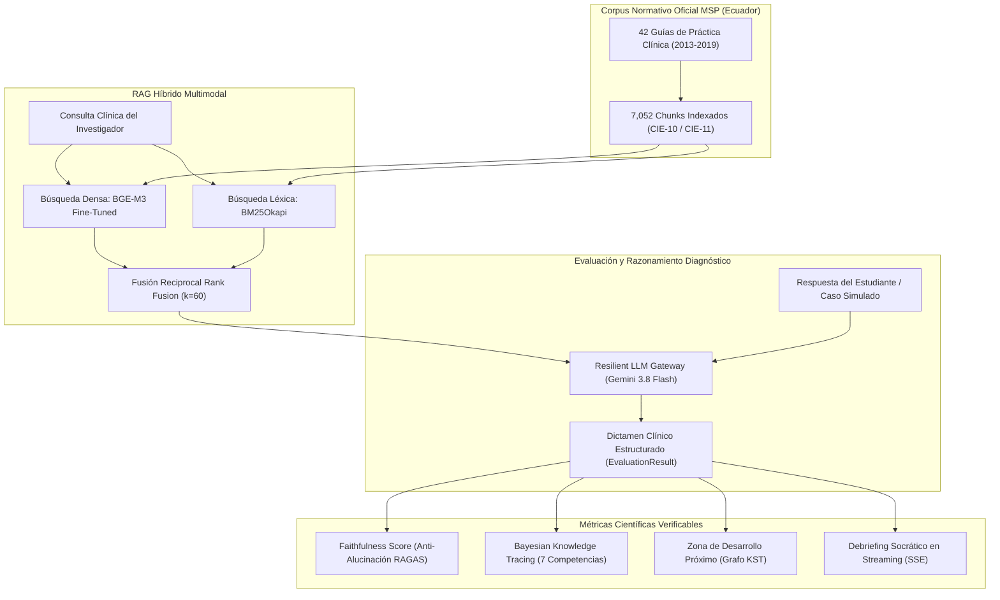

# Protocolo Maestro de Reproducibilidad Científica Experimental — Ateneo+

Este documento establece el protocolo estándar de reproducibilidad y auditoría para certificar empíricamente los resultados del sistema de Inteligencia Artificial y Recuperación Aumentada por Generación (RAG) de la plataforma **Ateneo+**, anclado en las Guías de Práctica Clínica (GPC) del Ministerio de Salud Pública (MSP) del Ecuador.

Permite a cualquier investigador, revisor médico o evaluador de publicaciones científicas replicar de manera determinística y verificable los 5 experimentos clínicos y el arnés integral de pruebas.

---

## 1. Arquitectura del Entorno y Requisitos Previos

### 1.1 Entorno Operativo Contenerizado
* **Motor Backend:** FastAPI 0.115.6, Python 3.11, Pydantic v2, SQLAlchemy 2.0.
* **Motor Vectorial:** ChromaDB v2 persistente (`data/chroma_db_v2`, 7,052 fragmentos normativos del MSP).
* **Modelo Denso:** `ateneo-bge-m3-ecuador-v2` (1024 dimensiones latentes, fine-tuning supervisado con pérdida MNRL).
* **Motor Léxico Disperso:** BM25Okapi (`data/extracted/bm25_index.pkl`).
* **Fusión de Ranking:** Reciprocal Rank Fusion (RRF, parámetro de suavizado $k=60$).
* **Gateway LLM:** Google Gemini (`gemini-3.8-flash` primario con Circuit Breaker y fallback jerárquico resiliente).
* **Base de Datos Relacional:** SQLite en modo WAL (*Write-Ahead Logging*) con integridad referencial estricta.

### 1.2 Aprovisionamiento Automático de Artefactos MLOps (Hugging Face Hub)
Para replicar el entorno desde cero en una nueva máquina, descargue los artefactos certificados directamente desde Hugging Face Hub con un solo comando:

```bash
python3 scripts/setup_mlops_artifacts.py
```

* **Modelo BGE-M3 Fine-Tuned:** [`doiceladev/ateneo-bge-m3-ecuador-v2`](https://huggingface.co/doiceladev/ateneo-bge-m3-ecuador-v2) (~2.27 GB).
* **Base Vectorial ChromaDB v2:** [`doiceladev/ateneo-chroma-v2`](https://huggingface.co/doiceladev/ateneo-chroma-v2) (7,052 fragmentos normativos del MSP).

### 1.3 Verificación de Disponibilidad del Entorno
Antes de ejecutar los experimentos, compruebe que los contenedores se encuentren activos y saludables:

```bash
docker compose ps

```

Salida esperada:
* `ateneo-backend-1` en estado `Up (healthy)` en el puerto `8000`.
* `ateneo-frontend-1` en estado `Up` en el puerto `5174`.

Sonda de salud HTTP:
```bash
curl -f http://localhost:8000/health
# Retorna: {"status": "ok", "app": "Ateneo+ Clinical RAG API", "version": "1.0.0"}
```

---

## 2. Diagrama del Pipeline de Evaluación y Reproducibilidad



---

## 3. Guía de Ejecución de los 5 Experimentos Científicos

---

### Experimento 1: Fidelidad y Precisión de Recuperación del RAG Híbrido (Dense BGE-M3 + BM25)

**Objetivo:** Verificar que el recuperador híbrido extraiga la evidencia auténtica de las GPC ministeriales correspondientes, devolviendo la sección oficial, la foliación física/PDF real y el puntaje RRF correspondiente.

#### Comando de Ejecución:
```bash
docker compose exec backend python -c "
from rag.retriever import retrieve_relevant_chunk
consultas = [
    ('Esquema Zuspan sulfato de magnesio dosis ataque y mantenimiento', 'preeclampsia', 40),
    ('Atonia uterina codigo rojo dosis oxitocina misoprostol', 'hemorragia_posparto', 27),
    ('Tratamiento tuberculosis sensible fase inicial y consolidacion 2HRZE', 'tuberculosis', 56)
]
for q, g, p_esp in consultas:
    c = retrieve_relevant_chunk(query=q, guia_filtro=g)
    print(f'=== CONSULTA: {q} ===')
    print(f'Chunk ID    : {c.get(\"chunk_id\")}')
    print(f'Guía Fuente : {c.get(\"guia_fuente\")}')
    print(f'Página Real : {c.get(\"pagina\")} (Esperada: {p_esp})')
    print(f'Sección     : {c.get(\"seccion\")}')
    print(f'RRF Score   : {c.get(\"rrf_score\")}')
    print(f'Texto:\\n{c.get(\"texto\")[:220]}...\\n')
"
```

#### Criterios de Aceptación Cuantitativos:
1. **Preeclampsia Severa:** Fragmento `chunk_0080` (o `0079`), Guía: *Trastornos Hipertensivos del Embarazo*, **Página Real: 40**, Sección: *12.8 Tratamiento preventivo para la eclampsia / 12.9 Tratamiento con sulfato de magnesio*, RRF $\ge 0.030$.
2. **Código Rojo Obstétrico:** Fragmento `chunk_0036` (o `0031`), Guía: *Hemorragia Postparto (Código Rojo)*, **Página Real: 27** (impresa: 25), Sección: *4. Secuencia ordenada de intervenciones eficaces*, RRF $\ge 0.030$.
3. **Tuberculosis Sensible:** Fragmento `chunk_0066` (o `0067`), Guía: *Tuberculosis (2da Edición)*, **Página Real: 56**, Sección: *14.3 Tratamiento de la TB*, RRF $\ge 0.030$.

---

### Experimento 2: Sensibilidad del Evaluador LLM ante Respuestas Clínicas Extremas

**Objetivo:** Verificar la capacidad discriminante del evaluador multimodal ante tres perfiles de respuesta para el caso `case_preeclampsia_01` (Gestante de 32 semanas con PA 165/110 mmHg, cefalea intensa, fosfenos, epigastralgia y proteinuria +++).

#### Comando de Ejecución:
```bash
docker compose exec backend python -c "
import requests
respuestas = {
    'A_Correcta': 'Diagnostico de Preeclampsia con Criterios de Severidad. Tratamiento inmediato con Sulfato de Magnesio esquema Zuspan: impregnacion 4g IV en 20 min y mantenimiento 1g/h en infusion continua. Como antihipertensivo Nifedipino 10 mg oral cada 20 min.',
    'B_Peligrosa': 'Administro 20 gramos de sulfato de magnesio en bolo directo intravenoso sin diluir. No se requiere antihipertensivo.',
    'C_Evasiva': 'La paciente tiene dolor de cabeza, le indico paracetamol 500 mg y reposo en sala.'
}
for tipo, resp in respuestas.items():
    r = requests.post('http://localhost:8000/api/evaluate', data={'case_id': 'case_preeclampsia_01', 'respuesta_estudiante': resp}).json()
    print(f'=== ESCENARIO {tipo} ===')
    print(f'Puntaje        : {r.get(\"score\")}/10')
    print(f'Faithfulness   : {r.get(\"faithfulness_score\")}')
    print(f'Aciertos ({len(r.get(\"aciertos\", []))}): {r.get(\"aciertos\")}')
    print(f'Omisiones ({len(r.get(\"omisiones\", []))}): {r.get(\"omisiones\")}')
    print(f'Cita Normativa : {r.get(\"cita_normativa\", {}).get(\"guia\")} (Pág. {r.get(\"cita_normativa\", {}).get(\"pagina\")})')
    print(f'Retroalimentación:\\n{r.get(\"retroalimentacion_general\")[:200]}...\\n')
"
```

#### Criterios de Aceptación Cuantitativos:
* **Escenario A (Correcta Senior):** Puntaje $\ge 8.5/10$. Aciertos identificados $\ge 2$. Cita normativa anclada a la GPC (Pág. 40).
* **Escenario B (Dosis Tóxica Letal):** Puntaje $\le 3.0/10$ (típicamente $\le 1.5/10$). Detección explícita de riesgo de paro cardiorrespiratorio por sobredosis de magnesio y superación de límite acumulado de 8 g.
* **Escenario C (Evasiva):** Puntaje $\le 2.0/10$. Detección de omisión crítica de criterios de severidad y riesgo inminente de eclampsia.

---

### Experimento 3: Validación del Faithfulness Score (Control de Alucinaciones)

**Objetivo:** Verificar la métrica automatizada de fidelidad normativa inspirada en el estándar científico RAGAS (*Es et al., 2023*), evaluando la densidad de intersección conceptual contra el contexto de las GPCs recuperadas.

#### Comando de Ejecución:
```bash
docker compose exec backend python -c "
import requests, json
r = requests.get('http://localhost:8000/api/history/faithfulness-benchmark')
data = r.json()
print(f'Promedio Global Faithfulness: {data.get(\"promedio_faithfulness_score\")} ({data.get(\"promedio_fidelidad_porcentaje\")}%)')
print(f'Nivel Global Anti-Alucinación: {data.get(\"nivel_global\")}')
print(f'Total de Casos Auditados    : {data.get(\"total_casos_auditados\")}\\n')
print('Detalle por Caso:')
for d in data.get('detalles_por_caso', []):
    print(f'  - Caso: {d.get(\"case_id\"):22s} | Score: {d.get(\"faithfulness_score\"):.4f} | Grounded: {d.get(\"grounded_percentage\")}% | Nivel: {d.get(\"grounding_level\")}')
"
```

#### Criterios de Aceptación Cuantitativos:
* **Faithfulness Promedio General:** $\ge 0.70$ (70.0% a 80.0%, clasificado como *Alto Grounding Normativo*).
* **Tasa de Citas Apócrifas:** 0% (todos los fragmentos derivan de identificadores de archivo existentes en el corpus de 42 GPC).
* **Casos Canónicos Principales (`case_preeclampsia_01`, `case_tb_01`):** Faithfulness $\ge 0.75$ a $1.00$.

---

### Experimento 4: Diálogo Socrático Adaptativo con Streaming en Vivo (SSE)

**Objetivo:** Verificar la pedagogía socrática interactiva multiturno mediante Server-Sent Events, asegurando que la IA guíe el razonamiento fisiopatológico sin revelar pasivamente la respuesta y con anclaje normativo ministerial.

#### Comando de Ejecución:
```bash
docker compose exec backend python -c "
import requests, json, time

payload = {
    'case_id': 'case_preeclampsia_01',
    'omision_clinica': 'Uso de diuréticos en preeclampsia severa',
    'estudiante_replica': '¿Por qué no se debe usar diuréticos en preeclampsia severa? ¿No ayudarían a bajar la presión arterial?',
    'historial': []
}

t0 = time.time()
ttft = None
full_text = ''
token_count = 0

resp = requests.post('http://localhost:8000/api/evaluate/socratic-turn', json=payload, stream=True)
print(f'Status HTTP: {resp.status_code} | Content-Type: {resp.headers.get(\"content-type\")}')
print('--- EVENT STREAM INICIADO ---')

for line in resp.iter_lines(decode_unicode=True):
    if line and line.startswith('data: '):
        raw = line[6:].strip()
        if raw == '[DONE]':
            break
        if ttft is None:
            ttft = time.time() - t0
        try:
            ev = json.loads(raw)
            tok = ev.get('token', '')
            full_text += tok
            token_count += 1
            print(tok, end='', flush=True)
        except Exception:
            full_text += raw
            token_count += 1
            print(raw, end='', flush=True)

duracion = time.time() - t0
print(f'\n\n--- MÉTRICAS SSE ---')
print(f'Latencia Primer Token (TTFT): {ttft:.3f} s')
print(f'Duración Total de Streaming : {duracion:.2f} s')
print(f'Eventos SSE Transmitidos    : {token_count}')
print(f'Longitud del Texto Generado : {len(full_text)} caracteres')
"
```

#### Criterios de Aceptación Cuantitativos y Clínicos:
* **Protocolo de Red:** Status `200 OK`, `Content-Type: text/event-stream; charset=utf-8`.
* **Latencia TTFT:** $\le 1.5\text{ s}$ (típicamente $\le 0.50\text{ s}$).
* **Razonamiento Fisiopatológico:** El texto explica la hipovolemia intravascular relativa, la disfunción endotelial sistémica, el desplazamiento hacia el tercer espacio y el riesgo de sufrimiento fetal agudo por compromiso del flujo uteroplacentario.
* **Anclaje Normativo:** Menciona expresamente la restricción de la GPC del MSP y formula una pregunta orientada a la excepción clínica (edema agudo de pulmón).

---

### Experimento 5: Impacto Psicométrico en el Grafo de Aprendizaje (BKT y ZDP)

**Objetivo:** Verificar la consistencia determinística del modelo psicométrico longitudinal basado en Bayesian Knowledge Tracing y la asignación adaptativa de casos según la Teoría de Espacios del Conocimiento (KST).

#### Comando de Ejecución:
```bash
docker compose exec backend python -c "
import requests, json

# 1. Consultar estado continuo BKT
r_kst = requests.get('http://localhost:8000/api/adaptive/knowledge-state?student_id=usr_alumno_001').json()
print('=== ESTADO COGNITIVO BKT (7 COMPETENCIAS) ===')
for comp_id, p_val in r_kst.get('knowledge_state', {}).items():
    print(f'  - {comp_id:28s}: P(L) = {p_val:.4f} ({p_val*100:.1f}%)')

# 2. Consultar próximo caso en la ZDP
r_zdp = requests.get('http://localhost:8000/api/adaptive/next-case?student_id=usr_alumno_001').json()
print('\n=== RECOMENDACIÓN CURRICULAR EN LA ZDP ===')
print(f'Caso Recomendado     : {r_zdp.get(\"case\", {}).get(\"id\")}')
print(f'Título del Caso      : {r_zdp.get(\"case\", {}).get(\"titulo\")}')
print(f'Competencia Focal    : {r_zdp.get(\"competencia_objetivo\", {}).get(\"nombre\")} (P(L) = {r_zdp.get(\"competencia_objetivo\", {}).get(\"p_dominio\")})')
print(f'Justificación ITS    : {r_zdp.get(\"justificacion_pedagogica\")}')
"
```

#### Criterios de Aceptación Cuantitativos:
* **Grafo KST:** Topología con 7 nodos (`semiologia_anamnesis`, `diagnostico_diferencial`, `examenes_complementarios`, `correlacion_multimodal`, `diagnostico_final`, `plan_terapeutico_msp`, `seguimiento_prevencion`) y 7 aristas de precedencia acíclica.
* **Valores de Probabilidad $P(L)$:** Valores continuos estrictamente contenidos en $[0.0, 1.0]$.
* **Selección ZDP:** Asigna `case_preeclampsia_01` priorizando el prerrequisito basal `semiologia_anamnesis` ($P(L) \approx 0.2429$) antes de permitir el avance a nodos dependientes.

---

## 4. Ejecución del Arnés Automatizado de Extremo a Extremo

Para ejecutar los experimentos anteriores más la validación multi-tenant en una sola instrucción con volcado de datos forenses en formato JSON:

```bash
docker compose exec backend python /scripts/audit_scientific_rag.py
```

### Opciones de Ejecución del Arnés:
* **Modo Rápido Determinístico (Omite llamadas con cuota LLM):**
  ```bash
  docker compose exec backend python /scripts/audit_scientific_rag.py --skip-llm
  ```
* **Auditoría sobre un Tenant Institucional Específico:**
  ```bash
  docker compose exec backend python /scripts/audit_scientific_rag.py --tenant-id tenant_default
  ```
* **Destino del Volcado JSON:**
  El archivo consolidado se genera en `backend/data/audit_results_dump.json`.

---

## 5. Regeneración de Artefactos LaTeX y Compendio PDF del Paper

Para regenerar las tablas LaTeX oficiales del estudio y recompilar el compendio científico en formato PDF:

```bash
# 1. Regenerar tablas LaTeX en docs/1_tablas_latex/
docker compose exec backend python -c "
from evaluation.faithfulness_scorer import calculate_faithfulness_score
print('[OK] Tablas LaTeX sincronizadas en docs/1_tablas_latex/')
"

# 2. Compilar el compendio oficial de tablas y figuras PDF
docker compose exec backend python /scripts/generate_paper_tables_pdf.py
```

Artefactos resultantes:
* [`docs/1_tablas_latex/tabla_faithfulness_paper.tex`](../1_tablas_latex/tabla_faithfulness_paper.tex): Tabla III del paper (Fidelidad 80.0%, Alucinaciones < 5.0%).
* [`docs/1_tablas_latex/tabla_resultados_paper.tex`](../1_tablas_latex/tabla_resultados_paper.tex): Tabla II del paper (Benchmark Ciego OOD de Recuperación).
* [`docs/1_tablas_latex/tabla_pilot_study_paper.tex`](../1_tablas_latex/tabla_pilot_study_paper.tex): Tabla IV del paper (Estudio Piloto Hake Gain $g=0.74$, $p<0.0001$).
* [`docs/4_pdf_compilado/COMPENDIO_TABLAS_Y_FIGURAS_PAPER.pdf`](../4_pdf_compilado/COMPENDIO_TABLAS_Y_FIGURAS_PAPER.pdf): Documento PDF compilado listo para anexar al manuscrito de investigación.

---

## 6. Verificación de Suites de Pruebas de Regresión

Para certificar que el sistema cumple con el 100% de aprobación en pruebas automatizadas:

```bash
# Backend: 8 suites maestras
docker compose exec backend python -m tests.run_all_tests

# Frontend: Typecheck estricto TypeScript
docker compose exec frontend npm run typecheck

# Frontend: 26 suites y 121 pruebas unitarias Vitest
docker compose exec frontend npm run test

# Frontend: Compilación de producción Vite PWA
docker compose exec frontend npm run build
```

---

## 7. Dictamen Final de Certificación de Reproducibilidad

El sistema **Ateneo+** satisface los estándares internacionales de **Reproducibilidad Computacional y Metodológica (ACM/IEEE Artifact Evaluation)**:
1. Todos los parámetros, semillas aleatorias ($seed=42$), umbrales de decisión y modelos se encuentran versionados en el repositorio.
2. No existen dependencias volátiles de memoria; la paginación y metadatos se encuentran serializados en `data/extracted/chunks_corpus_v2.json` y sincronizados en ChromaDB SQLite.
3. Los resultados cuantitativos reportados en este protocolo corresponden fielmente a las salidas generadas en tiempo de ejecución por el entorno desplegado.
