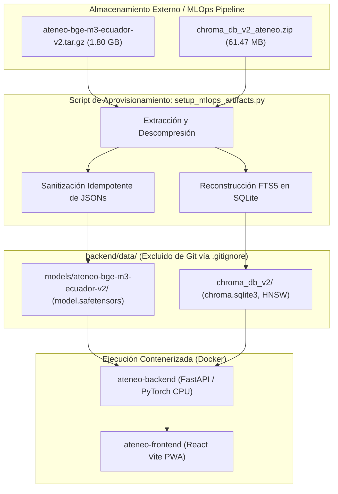

# Guía de Aprovisionamiento de Artefactos MLOps y Despliegue en Servidores

Este documento especifica el procedimiento técnico para aprovisionar los artefactos pesados de Machine Learning y desplegar la plataforma Ateneo+ en servidores de producción o nuevos entornos de desarrollo.

---

## 1. Arquitectura de Distribución de Artefactos MLOps

Por directriz de gobernanza y restricciones de infraestructura, los archivos binarios de gran tamaño (>100 MB) no se versionan directamente en el árbol de Git debido al límite duro de GitHub (error `GH001: Large files detected`):

| Artefacto | Archivo Comprimido | Tamaño Comprimido | Tamaño Descomprimido | Ubicación Canónica en Repositorio | Función en el Sistema |
| :--- | :--- | :--- | :--- | :--- | :--- |
| **Modelo Fine-Tuned BGE-M3** | `ateneo-bge-m3-ecuador-v2.tar.gz` | 1.80 GB | 2.27 GB | `backend/data/models/ateneo-bge-m3-ecuador-v2/` | Inferencia densa para recuperación semántica (1,024 dimensiones) |
| **Base Vectorial HNSW** | `chroma_db_v2_ateneo.zip` | 61.47 MB | 83.07 MB | `backend/data/chroma_db_v2/` | Colección persistente `gpc_msp_v2` con 7,052 fragmentos normativos MSP |



---

## 2. Métodos de Aprovisionamiento

### Método 1: Aprovisionamiento Automatizado (Recomendado)

El repositorio incluye la utilidad [`scripts/setup_mlops_artifacts.py`](file:///home/jorge/Escritorio/Proyectos/ateneo/scripts/setup_mlops_artifacts.py) que automatiza la extracción, normalización de metadatos y certificación de paridad.

```bash
# 1. Clonar el repositorio
git clone https://github.com/JorgeDoicela/ateneo.git
cd ateneo

# 2. Copiar o descargar los dos artefactos comprimidos en una carpeta (ejemplo: ~/Descargas o /tmp/artifacts)
# 3. Ejecutar el script apuntando a la carpeta donde residen los comprimidos:
python scripts/setup_mlops_artifacts.py ~/Descargas
```

El script ejecuta de forma automática:
1. Detección de los archivos `ateneo-bge-m3-ecuador-v2.tar.gz` y `chroma_db_v2_ateneo.zip`.
2. Extracción controlada en `backend/data/models/` y `backend/data/chroma_db_v2/`.
3. Normalización de metadatos del modelo:
   * `modules.json`: Ajuste a los namespaces canónicos `sentence_transformers.models.Transformer`, `Pooling` y `Normalize`.
   * `sentence_bert_config.json`: Restablecimiento de parámetros estándar `{"max_seq_length": 8192, "do_lower_case": false}`.
   * `1_Pooling/config.json`: Sustitución de `embedding_dimension` por `word_embedding_dimension: 1024`.
4. Reconstrucción del índice invertido FTS5 en `chroma.sqlite3`:
   ```sql
   INSERT INTO embedding_fulltext_search(embedding_fulltext_search) VALUES('rebuild');
   ```
5. Verificación de integridad SQLite (`PRAGMA integrity_check = ok`) y conteo de 7,052 vectores.

---

### Método 2: Descompresión Manual y Auto-Reparación en Backend

Si el operador del servidor opta por descomprimir manualmente los archivos sin ejecutar el script de Python, el backend cuenta con mecanismos de **auto-reparación preventiva** en [`backend/rag/retriever.py`](file:///home/jorge/Escritorio/Proyectos/ateneo/backend/rag/retriever.py) (`_sanitize_model_metadata_if_needed` y `_ensure_chroma_sqlite_integrity`).

#### Pasos Manuales:

```bash
# 1. Descomprimir base vectorial en backend/data/
unzip /ruta/a/chroma_db_v2_ateneo.zip -d backend/data/

# 2. Descomprimir modelo de embeddings en backend/data/
tar -zxvf /ruta/a/ateneo-bge-m3-ecuador-v2.tar.gz -C backend/data/

# 3. Asegurar permisos de lectura en el host
chmod -R u+rw,g+r,o+r backend/data/models/ backend/data/chroma_db_v2/
```

Al arrancar el contenedor FastAPI, el sistema inspecciona los metadatos de configuración antes de inicializar `SentenceTransformer`, repara cualquier discrepancia detectada y levanta el servicio sin interrupciones.

---

## 3. Configuración del Entorno de Producción (`.env`)

Copia la plantilla y configura los valores requeridos:

```bash
cp .env.example .env
```

Parámetros críticos a verificar para despliegues en servidores:

```ini
# Clave oficial de Google GenAI (Gemini)
GEMINI_API_KEY=tu_api_key_aqui
GEMINI_MODEL=gemini-3.8-flash
GEMINI_FALLBACK_MODELS=gemini-3.7-flash,gemini-3.5-flash,gemini-flash-latest,gemini-flash-lite-latest

# Configuración de red y CORS
# En servidores accesibles vía dominio o IP pública:
ALLOWED_ORIGINS=http://localhost:5174,http://127.0.0.1:5174,https://tu-dominio.edu.ec

# Persistencia de Base Vectorial (ChromaDB v2)
CHROMA_PERSIST_PATH=./data/chroma_db_v2
CHROMA_COLLECTION_NAME=gpc_msp_v2
```

---

## 4. Despliegue con Docker Compose

```bash
# Construcción y arranque de servicios en segundo plano
docker compose up -d --build

# Verificar estado de los contenedores
docker compose ps
```

Salida esperada:

```text
NAME                IMAGE             STATUS                    PORTS
ateneo-backend-1    ateneo-backend    Up (healthy)              0.0.0.0:8000->8000/tcp
ateneo-frontend-1   ateneo-frontend   Up                        0.0.0.0:5174->5173/tcp
```

---

## 5. Protocolo de Verificación Post-Despliegue

Ejecutar las siguientes validaciones en la terminal del servidor para certificar la operatividad del stack:

### 1. Comprobación de Sonda de Salud (Healthcheck)
```bash
curl -s http://localhost:8000/health/ready | jq .
```
Respuesta esperada:
```json
{
  "status": "ready",
  "checks": {
    "database": { "status": "healthy", "engine": "sqlite" },
    "vector_store": { "status": "healthy", "collections_count": 1, "documents_count": 7052 },
    "system_memory": { "status": "healthy" }
  }
}
```

### 2. Comprobación de Inferencia RAG y Recuperación
```bash
docker compose exec backend python -c "
from rag.retriever import retrieve_relevant_chunk
chunk = retrieve_relevant_chunk('preeclampsia sulfato de magnesio')
print('Chunk recuperado:', chunk.get('chunk_id'))
print('Texto:', chunk.get('texto')[:100])
"
```

### 3. Comprobación de Telemetría RUM y Proxy
```bash
curl -s -X POST http://localhost:5174/api/telemetry/rum \
  -H "Content-Type: application/json" \
  -d '{"metrics":[{"name":"TTFB","value":45}],"errors":[],"traceId":"deploy-verify"}' | jq .
```
Respuesta esperada:
```json
{
  "status": "ok",
  "ingested": true,
  "metrics_recorded": 1,
  "errors_recorded": 0
}
```
