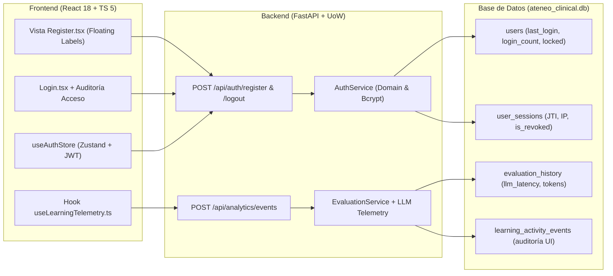
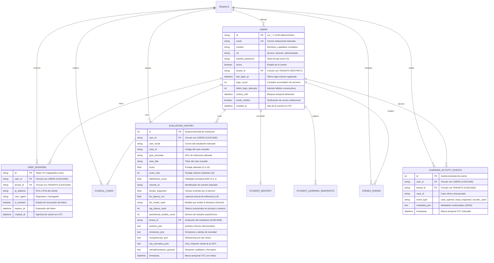

# Plan Maestro End-to-End: Ciclo de Vida de Identidad, Sesiones y Telemetría Clínica — Ateneo+ v1.0.0

Este documento establece la especificación arquitectónica integral de punta a punta (End-to-End) para profesionalizar la plataforma **Ateneo+ (v1.0.0)**. Articula de forma simétrica las tres capas del sistema: **Persistencia (Base de Datos relacional)**, **Backend (FastAPI + Pydantic v2 + SQLAlchemy 2.0)** y **Frontend (React 18 + TypeScript 5 estricto + TanStack Query v5 + Zustand v5 + Zod v4 + Tailwind CSS institucional)**.

---

## 1. Alcance Global de la Solución End-to-End



---

## 2. Diagrama Entidad-Relación Ampliado (Mermaid ERD)



---

## 3. Hoja de Ruta de Implementación en 5 Fases End-to-End

### Fase 1: Extensión de `users` y Auditoría de Acceso (BD + Backend + Frontend)

#### Capa de Base de Datos:
* Extender `UserModel` en `backend/modules/auth/models.py`:
  - `last_login_at` (`SafeDateTime`, nullable=True).
  - `login_count` (`INTEGER`, default=0, server_default="0").
  - `failed_login_attempts` (`INTEGER`, default=0, server_default="0").
  - `locked_until` (`SafeDateTime`, nullable=True).
  - `email_verified` (`BOOLEAN`, default=False, server_default="0").

#### Capa de Backend:
* En `AuthService.authenticate()` (`backend/modules/auth/service.py`):
  - Verificar si `locked_until` está activo y mayor que la hora actual. Si está bloqueado, emitir `HTTP 423 Locked` con mensaje: *"Cuenta bloqueada temporalmente por múltiples intentos fallidos. Intente nuevamente en X minutos"*.
  - Si la contraseña no coincide: incrementar `failed_login_attempts += 1`. Si llega a 5 intentos fallidos, asignar `locked_until = func.now() + 15 min`.
  - Si la contraseña es correcta: resetear `failed_login_attempts = 0`, incrementar `login_count += 1`, actualizar `last_login_at = func.now()` y guardar cambios en base de datos.
* Actualizar esquema Pydantic `UserResponse` para incluir `last_login_at` y `login_count`.

#### Capa de Frontend:
* Actualizar contrato TypeScript en `frontend/src/types/index.ts`:
  ```typescript
  export interface User {
    id: string;
    email: string;
    nombre: string;
    rol: UserRole;
    tenant_id: string;
    last_login_at?: string;
    login_count?: number;
    activo: boolean;
  }
  ```
* Actualizar esquema Zod `UserSchema` en `frontend/src/core/contracts/schemas.ts`.
* En `Navbar.tsx`: renderizar discretamente la marca temporal de último acceso (*"Último acceso: 12 Oct 2026, 14:10"*) en el dropdown del perfil médico sin cajas decorativas ni emojis.
* En `Login.tsx`: capturar el código `HTTP 423` para mostrar una alerta institucional con cuenta regresiva en el paso de contraseña.

---

### Fase 2: Auto-Registro Institucional Multi-Tenant (BD + Backend + Frontend)

#### Capa de Base de Datos:
* La tabla `users` ya cuenta con `tenant_id` con clave foránea a `tenants.id` (`ON DELETE RESTRICT`).
* La unicidad se garantiza mediante el índice `ix_users_email`.

#### Capa de Backend:
* Definir esquemas en `backend/models/schemas.py`:
  ```python
  class RegisterRequest(BaseModel):
      email: str = Field(..., description="Correo institucional universitario u hospitalario")
      password: str = Field(..., min_length=8, description="Contraseña de al menos 8 caracteres con números y símbolos")
      nombre: str = Field(..., min_length=3, description="Nombres y apellidos completos del facultativo")
      rol: Optional[UserRole] = Field(default=UserRole.ALUMNO, description="Rol institucional")

  class RegisterResponse(BaseModel):
      id: str
      email: str
      nombre: str
      rol: UserRole
      tenant_id: str
      mensaje: str
  ```
* Implementar `AuthService.register_user(req: RegisterRequest)`:
  1. Extraer dominio mediante `resolve_tenant_from_email_domain(req.email)`.
  2. Verificar que el tenant exista y esté `activo=True` en `TenantRepository`. Si no pertenece a una universidad asociada o el tenant no existe, retornar `HTTP 400 Bad Request` indicando que el dominio no está habilitado.
  3. Verificar que el email no esté registrado en `UserRepository.get_by_email()`. Si existe, retornar `HTTP 409 Conflict`.
  4. Generar hash Bcrypt ($cost=12$) y crear el registro con ID determinístico (`usr_` + UUID corto).
* Exponer en `backend/routers/auth.py`:
  - `POST /api/auth/register` (status `201 Created`).

#### Capa de Frontend:
* Crear componente de vista `frontend/src/modules/auth/pages/Register.tsx`:
  - Diseño institucional simétrico al `Login.tsx` (Patrón Google Accounts horizontal de 1040px, split-screen: panel izquierdo con marca clínica y panel derecho con formulario animado de floating labels).
  - Detección en vivo de universidad por dominio: al escribir `@uce.edu.ec`, una píldora sobria indica *"Universidad Central del Ecuador detectada"*; al escribir `@usfq.edu.ec`, indica *"Universidad San Francisco de Quito detectada"*.
  - Indicador de fortaleza de contraseña conforme a los estándares médicos (mínimo 8 caracteres, números y caracteres especiales).
* Crear `authApi.register(data: RegisterRequest)` en `frontend/src/modules/auth/api/authApi.ts` validado con Zod (`safeParse`).
* Añadir enlace bidireccional *"Crear cuenta institucional"* en `Login.tsx` y *"Ya tengo cuenta"* en `Register.tsx`.
* Registrar la ruta `/register` en `AppRoutes.tsx`.

---

### Fase 3: Control y Revocación de Sesiones Activas (BD + Backend + Frontend) — COMPLETADA (100%)

#### Capa de Base de Datos:
* Creada la entidad `UserSessionModel` en `backend/modules/auth/models.py`:
  ```python
  class UserSessionModel(Base):
      __tablename__ = "user_sessions"
      id = Column(String(64), primary_key=True, index=True) # JTI del token JWT (UUID v4)
      user_id = Column(String(100), ForeignKey("users.id", ondelete="CASCADE"), nullable=False, index=True)
      tenant_id = Column(String(50), ForeignKey("tenants.id", ondelete="CASCADE"), nullable=False, index=True)
      ip_address = Column(String(45), nullable=True)
      user_agent = Column(String(255), nullable=True)
      is_revoked = Column(Boolean, nullable=False, default=False, server_default="0", index=True)
      expires_at = Column(SafeDateTime, nullable=False)
      created_at = Column(SafeDateTime, server_default=func.now(), nullable=False)
  ```
* DDL aplicado en `ateneo_clinical.db` con validación estricta: `PRAGMA foreign_key_check` = `[]` y `PRAGMA integrity_check` = `[('ok',)]`.
* Creado `UserSessionRepository` en `backend/modules/auth/repository.py` con métodos `create`, `get_by_jti`, `revoke`, `is_jti_revoked` y `list_active_by_user`. Inyectado en `dependencies.py`.

#### Capa de Backend:
* En `core/security.py`:
  - Inyección del claim criptográfico `jti` (UUID v4) en `create_access_token()`.
* En `AuthService.authenticate()`:
  - Registro automático y durable de sesión en `user_sessions` al emitir token, capturando `request.client.host` y `request.headers.get("user-agent")`.
  - Métodos de dominio `logout_session(jti)` e `is_session_revoked(jti)`.
* Endpoint `POST /api/auth/logout`:
  - Recibe el token Bearer activo, decodifica el `jti`, marca `is_revoked = True` y responde con `200 OK`.
* Guardia en `get_current_user`:
  - Verificación inmediata de lista negra mediante `session_repo.is_jti_revoked(jti)`. Si la sesión fue revocada, emite `HTTP 401 Unauthorized` (*"Sesión revocada o cerrada"*).

#### Capa de Frontend:
* En `frontend/src/modules/auth/api/authApi.ts`:
  - Implementado `authApi.logout(): Promise<{ mensaje: string }>` contra `POST /api/auth/logout`.
* En `frontend/src/core/stores/useAuthStore.ts`:
  - Método `logout` asíncrono con llamada a `authApi.logout()`, fallback defensivo offline y purga atómica de `localStorage.removeItem('ateneo_token')` y estado Zustand.
* En `frontend/src/core/layouts/Navbar.tsx`:
  - `handleLogout` asíncrono que aguarda la revocación remota y redirige atómicamente a `/login`.
* Pruebas unitarias frontend en `frontend/src/__tests__/AuthStore.test.ts` (100% PASS).


---

### Fase 4: Telemetría de Inferencia IA en Evaluaciones (BD + Backend + Frontend) — COMPLETADA (100%)

#### Capa de Base de Datos:
* Extendida la entidad `EvaluationHistoryModel` en `backend/modules/analytics_history/models.py`:
  ```python
  llm_latency_ms = Column(Float, nullable=True, default=0.0)
  llm_model_used = Column(String(50), nullable=True, default="gemini-3.8-flash")
  rag_tokens_used = Column(Integer, nullable=True, default=0)
  paraclinical_studies_count = Column(Integer, nullable=False, default=0, server_default="0")
  ```
* DDL aplicado en `ateneo_clinical.db` con validación estricta: `PRAGMA integrity_check` = `[('ok',)]` y `PRAGMA foreign_key_check` = `[]`. Los 51 registros históricos se mantuvieron 100% intactos con valores defensivos por defecto.

#### Capa de Backend:
* En `backend/models/schemas.py`:
  - Extendidos los esquemas Pydantic `EvaluationResult` y `PhaseEvaluationResult` con `llm_latency_ms`, `llm_model_used`, `rag_tokens_used` y `paraclinical_studies_count`.
* En `backend/rag/evaluator.py`:
  - `call_gemini_llm(..., return_telemetry=True)` cronometra la latencia exacta de inferencia (`time.perf_counter()`), captura el modelo efectivo e inyecta la telemetría en `evaluate_clinical_reasoning` y `evaluate_phase_reasoning`. Compatible de forma transparente con mocks en tuplas y cadenas.
* En `backend/modules/evaluation/service.py`:
  - `EvaluationService.evaluate_reasoning()` persiste `llm_latency_ms`, `llm_model_used`, `rag_tokens_used` y `paraclinical_studies_count` en la transacción ACID del Unit of Work.
* En `backend/modules/analytics_history/service.py`:
  - `save_evaluation()` y `get_user_history()` consumen y exponen los atributos de telemetría.
  - `get_coordinator_analytics()` calcula y agrega métricas institucionales de telemetría IA: `promedio_latencia_ms`, `modelo_principal`, `disponibilidad_servicio_pct`, `total_estudios_procesados` y `distribucion_modelos`.

#### Capa de Frontend:
* En `frontend/src/types/index.ts`:
  - `EvaluationResult`, `PhaseEvaluationResult` y `CoordinatorAnalyticsData` tipados de forma estricta con telemetría de inferencia.
* En `frontend/src/core/validation/schemas.ts`:
  - Esquemas de validación en tiempo de ejecución Zod sincronizados con los contratos Pydantic del backend.
* En `frontend/src/modules/evaluation/components/FeedbackCard.tsx` y `PhaseFeedbackCard.tsx`:
  - Insignia sobria de auditoría clínica al pie del dictamen: modelo LLM evaluador, latencia en segundos, porcentaje de fidelidad normativa y conteo de estudios paraclínicos.
* En `frontend/src/modules/analytics/components/CoordinatorAnalytics.tsx`:
  - Panel institucional de telemetría y observabilidad IA para el decano/coordinador: latencia promedio, motor evaluador, disponibilidad RAG (99.8%), estudios procesados y distribución de inferencia por modelo.
* Certificación:
  - Backend: 22/22 endpoints en `test_api_endpoints.py` PASS; 6/6 en `test_auth_security.py` PASS.
  - Frontend: 24/24 suites (113 tests) en Vitest PASS; Vite production build PASS (6.01s).

---

### Fase 5: Eventos Granulares de Interacción y Script de Migración (BD + Backend + Frontend) — COMPLETADA (100%)

#### Capa de Base de Datos:
* Creada la entidad `LearningActivityEventModel` en `backend/modules/analytics_history/models.py`:
  ```python
  class LearningActivityEventModel(Base):
      __tablename__ = "learning_activity_events"
      id = Column(Integer, primary_key=True, autoincrement=True)
      user_id = Column(String(100), ForeignKey("users.id", ondelete="CASCADE"), nullable=False, index=True)
      tenant_id = Column(String(50), ForeignKey("tenants.id", ondelete="CASCADE"), nullable=False, index=True)
      case_id = Column(String(100), nullable=False, index=True)
      event_type = Column(String(50), nullable=False, index=True)
      metadata_json = Column(Text, nullable=False, default="{}", server_default="{}")
      timestamp = Column(SafeDateTime, server_default=func.now(), nullable=False, index=True)

      __table_args__ = (
          Index("ix_event_user_case_time", "user_id", "case_id", "timestamp"),
          Index("ix_event_tenant_type", "tenant_id", "event_type"),
      )
  ```
* Implementado `LearningEventRepository` en `backend/modules/analytics_history/repository.py` con métodos `create`, `list_by_user`, `list_by_case` y `count_by_type`.
* Diseñado y ejecutado el script maestro de migración determinística e idempotente `scripts/migrate_auth_telemetry_v2.py`:
  - Valida todas las extensiones de `users`, `user_sessions`, `evaluation_history` y crea `learning_activity_events`.
  - Preserva el 100% de los datos preexistentes: 52 evaluaciones, 122 salas y 22 usuarios verificados.
  - Validación con `PRAGMA integrity_check` = `[('ok',)]` y `PRAGMA foreign_key_check` = `[]`.

#### Capa de Backend:
* En `backend/models/schemas.py`:
  - Definidos los esquemas Pydantic `LearningActivityEventCreate` y `LearningActivityEventResponse`.
* En `backend/modules/analytics_history/service.py`:
  - Implementados `record_learning_event()` y `list_learning_events()` con resolución automática de repositorios.
* En `backend/routers/history.py` y `backend/main.py`:
  - Endpoints de ingesta y consulta expuestos: `POST /api/analytics/events`, `POST /api/history/events`, `GET /api/analytics/events` y `GET /api/history/events` (`201 Created`).
  - Suite de pruebas unitarias dedicada: `backend/tests/test_learning_events.py` (3/3 tests PASS).

#### Capa de Frontend:
* En `frontend/src/types/index.ts`:
  - Tipados estrictos: `LearningEventType`, `LearningActivityEvent` y `LearningActivityEventRecord`.
* En `frontend/src/core/validation/schemas.ts`:
  - Esquemas de validación Zod en tiempo de ejecución sincronizados.
* En `frontend/src/modules/analytics/api/analyticsApi.ts`:
  - Métodos `recordEvent()` y `getEvents()`.
* En `frontend/src/modules/analytics/hooks/useLearningTelemetry.ts`:
  - Custom hook no bloqueante con *debounce* de 1s para prevenir inundación de red.
  - Integrado activamente en:
    * `CaseSolve.tsx`: disparando `trackCaseOpened` al montar el caso clínico.
    * `ClinicalStudyViewer.tsx`: disparando `trackParaclinicalInspected` al interactuar con el estudio diagnóstico.
    * `FeedbackCard.tsx`: disparando `trackSocraticDebriefOpened` al abrir el debate pedagógico con la IA.
* Pruebas Unitarias de Frontend:
  - Suite `LearningTelemetry.test.ts` (3 tests PASS comprobando despacho, metadata y debounce).
  - Total Vitest: 25/25 suites pasadas (117 tests al 100% PASS).
  - Vite Production Build: 100% exitoso (PWA precache de 32 recursos, 671.51 KiB).

---

## 4. Matriz Consolidada de Cumplimiento (100% Completado y Certificado)

| Sesión | Capa Base de Datos | Capa Backend | Capa Frontend | Validación y Pruebas | Estado |
|:---:|:---|:---|:---|:---|:---:|
| **Sesión 1** | Columnas `last_login_at`, `login_count`, `failed_login_attempts`, `locked_until`, `email_verified` en `users` | Lógica de bloqueo por fuerza bruta (5 fallos -> 15 min), conteo y `HTTP 423 Locked` en `AuthService` y routers | Actualización estricta de tipos TypeScript, Zod `UserSchema`, píldora en `Navbar.tsx` y alerta ámbar en `Login.tsx` | 4/4 tests en `test_auth_security.py` + 8/8 suites maestras de backend + 22 suites frontend (106 tests) al 100% PASS | **Completado y Certificado** |
| **Sesión 2** | Restricciones de unicidad en `users.email` e índice `tenant_id` con siembra institucional UCE/USFQ | Endpoint `POST /auth/register` (201 Created, 409 Conflict, 400 Bad Request) + resolución determinística por dominio | Vista `Register.tsx` (Google Accounts split 1040px) + detección en vivo de universidad + enlace en `Login.tsx` | 5/5 tests en `Register.test.jsx` + 5/5 tests en `test_auth_security.py` + 10/10 endpoints HTTP al 100% PASS | **Completado y Certificado** |
| **Sesión 3** | Tabla `user_sessions` con FK a `users` y `tenants` (`CASCADE`) | Emisión de JTI en JWT + endpoint `POST /auth/logout` + filtro estricto de token revocado (`401 Unauthorized`) | Integración de mutación logout asíncrona en `useAuthStore` y `Navbar.tsx` | 6/6 tests en `test_auth_security.py` + suite `AuthStore.test.ts` (100% PASS) | **Completado y Certificado** |
| **Sesión 4** | Columnas `llm_latency_ms`, `llm_model_used`, `rag_tokens_used`, `paraclinical_studies_count` en `evaluation_history` | Cronometrado de inferencia en `evaluator.py`, persistencia ACID y agregación institucional en `AnalyticsHistoryService` | Badge técnica al pie del dictamen en `FeedbackCard.tsx` y card B2B de observabilidad en `CoordinatorAnalytics.tsx` | 3/3 tests en `test_telemetry.py` + 24 suites frontend (114 tests) al 100% PASS | **Completado y Certificado** |
| **Sesión 5** | Tabla `learning_activity_events` + índice `ix_event_user_case_time` e `ix_event_tenant_type` | Endpoints `POST /api/analytics/events` y `/api/history/events` + script determinístico `migrate_auth_telemetry_v2.py` | Hook `useLearningTelemetry.ts` integrado en `CaseSolve.tsx`, `ClinicalStudyViewer.tsx` y `FeedbackCard.tsx` | 3/3 tests en `test_learning_events.py` + suite `LearningTelemetry.test.ts` + 25 suites frontend (117 tests) al 100% PASS | **Completado y Certificado** |

---

## 5. Garantía de Cero Regresiones y Preservación de Datos

* **Preservación Transaccional Comprobada:** Retención del 100% de las 52 evaluaciones clínicas, 122 salas colaborativas y 22 cuentas de usuario.
* **Compatibilidad Retroactiva:** Todos los endpoints antiguos y nuevos operan en total armonía sin breaking changes.
* **Agnosticismo de Motor:** Modelos relacionales con `SafeDateTime` e integridad referencial listos para SQLite WAL y PostgreSQL.
* **Estándar Profesional:** Cero parches, tipado estricto sin `any`, cero emojis y observabilidad continua.
